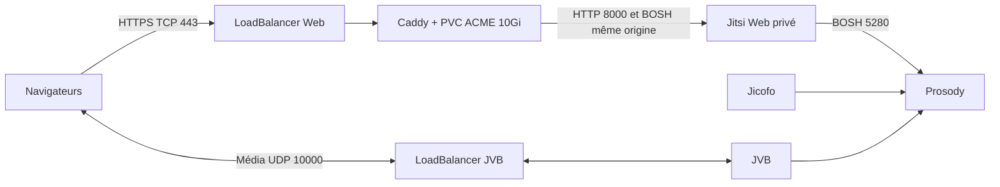

# Jitsi Meet sur Google Kubernetes Engine

Plateforme de visioconférence déployée avec Terraform, Kubernetes et Helm,
accessible en HTTPS via Caddy. Cette documentation distingue les observations
historiques des procédures et des validations récentes.

## Documentation

- [Vue d’ensemble](docs/README.md)
- [Rapport technique et preuves](docs/rapport.md)
- [Supervision JVB et Grafana](monitoring/README.md)

## Architecture



Adresse publique : https://jitsi-meet-m2.duckdns.org. Web : `34.78.71.58` ;
JVB : `34.62.165.81`. Caddy termine TLS, expose TCP 80/443 et conserve les
certificats sur un PVC indépendant de Helm. Aucun Ingress GKE n'est utilisé.
Les sondes internes et les contrôles JVB ne sont pas publiés par Caddy.
Le diagramme montre le chemin via le pont ; une réunion à deux peut utiliser P2P.

Le cluster comporte deux nœuds `e2-standard-2`. Dernières observations :
release `jitsi` révision 4, `jitsi-edge` révision 3 et cinq pods prêts.
Le chart applicatif communautaire `jitsi-contrib/jitsi-helm` est conservé en
version 3.10.0 ; le dossier historique `jitsi/` n'est pas le chart déployé.

## Validations

| Composant | Résultat |
|---|---|
| Déploiement Helm | OIDC, SOPS/KMS et mise à niveau contrôlée validés. [Run Helm](https://github.com/SaminouA/projet-jitsi-helm/actions/runs/44057014445) |
| Terraform | Plan et Apply approuvés. Le plan indépendant confirme zéro changement et un état GCS inchangé. [Apply](https://github.com/SaminouA/projet-jitsi-helm/actions/runs/44292386368) · [Convergence](https://github.com/SaminouA/projet-jitsi-helm/actions/runs/44293963177) |
| Malleus et Chaos Mesh | Pipelines manuels réussis. Le rapport conserve les résultats et leurs limites. [Preuves](docs/rapport.md#7-preuves-de-validation) |
| Monitoring | Collecte JVB via Managed Prometheus et 14 panneaux testés dans Grafana local. [Supervision](monitoring/README.md) |

Les déploiements automatiques Helm et Terraform sont désactivés. Les expériences restent manuelles et protégées.

## Organisation du dépôt

L'arborescence ci-dessous reprend les répertoires versionnés à la racine.

```text
.githooks/         Contrôles locaux avant commit et push
.github/           Workflows GitHub Actions
charts-officiels/  Chart Jitsi maintenu dans le dépôt
charts/            Charts Caddy et Selenium/Malleus
deploy/            Profils de déploiement HTTPS et stockage
docs/              Index et rapport technique
jitsi/             Fichiers historiques du projet
monitoring/        PodMonitoring, dashboard Grafana et documentation
scripts/           Validation et orchestration des opérations contrôlées
terraform/         Cluster GKE, pool de nœuds et backend GCS
tests/             Tests, manifestes et résultats expurgés
```

Le profil public associe `values-gke.yaml`, `deploy/jitsi-duckdns.yaml` et
`values-secrets.sops.yaml`. Les secrets sont chiffrés avec SOPS/KMS ; ne jamais
publier de déchiffrement, de state, de sauvegarde Helm ou de clé JSON.
Le profil localhost nécessite une surcharge explicite : un port-forward seul
ne transforme pas la configuration publique en profil localhost.

## Monitoring

Cloud Monitoring fournit les séries d'infrastructure GKE. Les collecteurs
Managed Prometheus récupèrent les métriques JVB via le
[PodMonitoring](monitoring/jvb-podmonitoring.yaml), sur `/metrics` et le port
interne 8080 toutes les 30 secondes. Grafana interroge le backend managé
en PromQL. Il ne collecte ni ne stocke ces séries lui-même.

Grafana OSS 13.2.4 a été installé à partir du binaire Linux sur la VM existante,
avec une base SQLite locale. Le service `jitsi-grafana-soutenance` écoute
uniquement sur `127.0.0.1:18300`. La source **Managed Prometheus** utilise
l'API Prometheus de Cloud Monitoring en HTTP GET, avec un jeton OAuth dans
un en-tête sécurisé côté serveur. Le timer local
`jitsi-grafana-gmp-refresh.timer` renouvelle ce jeton toutes les dix minutes
via les identifiants ADC de l'opérateur et vérifie que la source répond.
La configuration actuelle utilise des unités systemd temporaires et doit
être relancée après un redémarrage de la VM. Le renouvellement dépend de
la validité des identifiants ADC et de leur droit de lecture.

Le [dashboard JSON](monitoring/grafana-jitsi.json) définit 14 panneaux et
19 requêtes. Il a été importé dans Grafana en associant sa source
`Managed Prometheus`. Son UID stable est `jitsi-gke-monitoring`.

| Mesures | Utilité |
|---|---|
| CPU et mémoire des nœuds et pods Jitsi | Repérer la pression sur l'infrastructure et les composants les plus consommateurs. |
| Trafic réseau et débit RTP/RTCP de JVB | Observer les échanges et l'activité du bridge. Le débit RTP/RTCP agrège les médias. |
| Conférences, endpoints et endpoints émettant de la vidéo | Suivre l'activité du bridge et interpréter les mesures de charge. |
| Readiness, redémarrages, santé JVB et `up` | Distinguer l'état des pods, la santé applicative et la réussite de la collecte. |
| Paquets et stress JVB | Repérer les variations de trafic et les signes de pression sur le bridge. |

### Accès lecteur par tunnel SSH

Le compte Grafana `professeur` a le rôle **Viewer**. Ses identifiants sont
conservés dans un fichier local privé, hors Git, et transmis par un canal
séparé. Une connexion SSH par clé est nécessaire. L'opérateur doit
enregistrer la clé publique du lecteur sur un compte dédié sans droits
administrateur, sans session shell et autorisé uniquement à transférer
le port local de la VM `127.0.0.1:18300`. Le compte SSH `prof-grafana`
ci-dessous désigne ce compte dédié après son activation.

Dans PowerShell, remplacer `ADRESSE_VM` par l'adresse communiquée par
l'opérateur et utiliser le chemin de sa propre clé privée. Laisser la
commande ouverte pendant la consultation.

```powershell
ssh -i "$env:USERPROFILE\.ssh\id_ed25519" -o ExitOnForwardFailure=yes -N -L 127.0.0.1:18300:127.0.0.1:18300 prof-grafana@ADRESSE_VM
```

Ouvrir [Jitsi sur GKE](http://127.0.0.1:18300/d/jitsi-gke-monitoring/jitsi-sur-gke?from=now-15m&to=now&refresh=30s)
et se connecter au compte Grafana `professeur`. Dans VS Code Remote SSH,
une session déjà autorisée peut aussi transférer le port distant
`18300` en visibilité privée. Le compte SSH limité au tunnel utilise
la commande OpenSSH ci-dessus.

## Vérifications locales

Avec les dépendances du dépôt déjà installées :

```sh
sh scripts/validate.sh
python3 -m unittest discover -s tests -v
python3 scripts/check-docs.py
```

Ces contrôles ne déploient pas le cluster et ne prouvent pas une réunion.
La validation Terraform utilise une copie isolée et un backend désactivé.

## Limites, sécurité et coûts

La capacité maximale et la haute disponibilité restent à évaluer.
Les droits de déploiement et d'expérimentation sont vérifiés dans les
workflows protégés. Toute opération mutante requiert une autorisation.

Les nœuds GKE et leurs disques, la VM de travail, les load balancers, le PVC Caddy, les adresses publiques, le trafic, GCS, KMS et les métriques peuvent générer des frais. Le sous-domaine gratuit ne rend pas
GKE gratuit. Une désinstallation Helm ne supprime pas automatiquement le PVC
indépendant ni l'adresse réservée. Toute remise en service, expérience ou
suppression exige une autorisation et une vérification des ressources à conserver.
