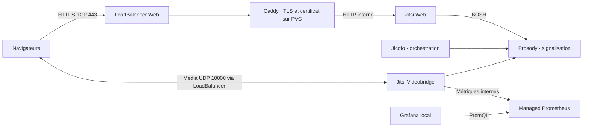

# Jitsi Meet sur Google Kubernetes Engine

Ce projet déploie une plateforme de visioconférence accessible en HTTPS sur un cluster GKE de deux nœuds. Il couvre le déploiement, la sécurisation, les tests vidéo, la reprise après une panne ciblée et la supervision. [Rapport technique et preuves](docs/rapport.md)

## Architecture et technologies



Terraform gère le cluster et son état distant dans GCS. Helm déploie le chart Jitsi Meet 3.10.0 et le chart Caddy. DuckDNS fournit le nom public et Caddy termine TLS. Une réunion à deux peut utiliser le mode pair à pair.

## Workflows et secrets

| Workflow | Déclencheur | Fonction |
|---|---|---|
| `helm-ci.yml` | Push, pull request vers `main` ou lancement manuel | Valide les profils Helm et Terraform avec un backend désactivé. |
| `deploy-gke.yml` | Fin de la CI sur `main` | Déploie avec Helm après une CI réussie sur un push du dépôt et activation explicite. |
| `terraform-gke.yml` | Manuel sur `main` | Génère un plan contrôlé ou applique le plan approuvé pour le changement de label prévu. |
| `diagnose-gke.yml` | Manuel sur `main` avec confirmation | Vérifie l'accès OIDC à GKE et le déchiffrement SOPS en lecture seule. |
| `build-selenium.yml`, `build-malleus.yml` | Manuel | Construit et publie les images utilisées pour les essais vidéo. |
| `malleus-controlled.yml`, `chaos-controlled.yml` | Manuel, avec environnement protégé | Exécute un essai vidéo borné ou une suppression ciblée du pod Web. |

GitHub Actions s'authentifie auprès de Google Cloud avec OIDC. Les valeurs sensibles de Helm sont versionnées sous forme chiffrée avec SOPS et Cloud KMS. [Démarche de déploiement](docs/rapport.md#3-étapes-de-réalisation)

## Tests et résultats

| Validation | Résultat observé |
|---|---|
| Helm et Terraform | Mise à niveau Helm validée avec OIDC et SOPS/KMS. Le plan Terraform indépendant a confirmé zéro changement après application. |
| Vidéo avec Selenium et Malleus | Deux participants et trois relevés montrant des échanges vidéo dans les deux sens sur 49,1 s. |
| Reprise avec Chaos Mesh | Après la suppression ciblée du pod Web, son remplaçant est redevenu Ready. L'expérience s'est déroulée sans réunion active. |
| Supervision | Les 19 requêtes des 14 panneaux Grafana renvoient des séries réelles couvrant les nœuds, les pods et le bridge Jitsi. |

Les mesures vidéo couvrent les relevés échantillonnés. La capacité maximale, la haute disponibilité, TURN et la continuité d'une réunion pendant une panne restent à évaluer. [Preuves de validation](docs/rapport.md#7-preuves-de-validation)

## Supervision

Cloud Monitoring fournit les métriques GKE. Google Cloud Managed Service for Prometheus collecte celles de Jitsi Videobridge toutes les 30 secondes via un `PodMonitoring` ciblant le port interne 8080 et le chemin `/metrics`. Grafana OSS, installé sur la VM et lié à localhost, interroge le backend managé en PromQL via une source Prometheus avec authentification OAuth renouvelée automatiquement.

Le dashboard JSON est importé en sélectionnant la source **Managed Prometheus**. Ses 14 panneaux couvrent le CPU, la mémoire, le réseau, la readiness, les redémarrages, l'activité et la santé du bridge, ainsi que l'état de la collecte. Il s'ouvre sur les 15 dernières minutes et s'actualise toutes les 30 secondes. [Guide de supervision](monitoring/README.md) · [Dashboard JSON](monitoring/grafana-jitsi.json)

## Arborescence du projet

```text
.
├── .github/                                # Automatisation GitHub Actions
│   └── workflows/                          # Définition des workflows
│       ├── helm-ci.yml                     # Validation Helm et Terraform
│       ├── deploy-gke.yml                  # Déploiement Helm conditionnel
│       ├── diagnose-gke.yml                # Diagnostic OIDC, GKE et SOPS
│       ├── terraform-gke.yml               # Plan et application contrôlés
│       ├── build-selenium.yml              # Construction de l’image Selenium
│       ├── build-malleus.yml               # Construction de l’image Malleus
│       ├── malleus-controlled.yml          # Essai vidéo contrôlé
│       └── chaos-controlled.yml            # Expérience Chaos Mesh ciblée
├── terraform/                              # Provisionnement GKE
│   ├── main.tf                             # Cluster GKE et pool de nœuds
│   ├── backend.tf                          # Backend distant GCS
│   ├── provider.tf                         # Configuration du fournisseur Google
│   ├── versions.tf                         # Contraintes de version
│   └── .terraform.lock.hcl                 # Version verrouillée du fournisseur
├── charts-officiels/                       # Chart communautaire conservé dans le dépôt
│   └── jitsi-meet/                         # Chart Jitsi Meet utilisé sur GKE
│       ├── Chart.yaml                      # Métadonnées et version du chart
│       ├── values.yaml                     # Valeurs par défaut du chart
│       └── templates/                      # Manifestes Web, Prosody, Jicofo et JVB
├── charts/                                 # Charts complémentaires
│   ├── jitsi-edge/                         # Passerelle HTTPS Caddy
│   │   ├── Chart.yaml                      # Métadonnées du chart Caddy
│   │   ├── values.yaml                     # Valeurs par défaut de la passerelle
│   │   └── templates/                      # Configuration, déploiement et service Caddy
│   └── jitsi-load-test/                    # Environnement de test vidéo
│       ├── Chart.yaml                      # Métadonnées du chart de test
│       ├── values.yaml                     # Paramètres de Selenium et Malleus
│       └── templates/                      # Manifestes du scénario vidéo
│           ├── selenium.yaml               # Grid Selenium dans Kubernetes
│           └── malleus.yaml                # Job Malleus
├── jitsi/                                  # Chart historique
├── deploy/                                 # Profils et manifestes de déploiement
│   ├── jitsi-duckdns.yaml                  # Valeurs du profil Jitsi public
│   ├── jitsi-edge-duckdns.yaml             # Valeurs Caddy et DuckDNS
│   ├── jitsi-edge-storage.yaml             # PVC des certificats ACME
│   ├── cd-pvc-reader.yaml                  # Droits de lecture du PVC pour la CD
│   └── terraform/                          # Manifestes RBAC et ajustement OIDC
├── scripts/                                # Contrôles et orchestration
│   ├── validate.sh                         # Validation locale et CI
│   ├── deploy-gke.sh                       # Pilotage du déploiement Helm
│   ├── terraform-controlled.py             # Garde-fous des opérations Terraform
│   ├── controlled-experiment.py            # Orchestration des expériences
│   ├── observe-malleus-video.py            # Observation des flux vidéo
│   ├── observe-chaos-web.py                # Observation du remplacement du pod Web
│   └── check-docs.py                       # Vérification des liens de documentation
├── tests/                                  # Tests automatisés et scénarios
│   ├── load/                               # Essais vidéo Selenium et Malleus
│   │   ├── docker/                         # Images et tests de démarrage
│   │   ├── values-video-2x90.yaml          # Scénario vidéo à deux participants
│   │   ├── values-video-2x90-low-cpu.yaml  # Variante avec demandes CPU réduites
│   │   └── video-results-summary.json      # Synthèse des essais vidéo
│   └── chaos/                              # Essai de résilience Chaos Mesh
│       ├── podchaos-web-once.yaml          # Suppression ciblée du pod Web
│       ├── values-controller-only.yaml     # Valeurs du contrôleur Chaos Mesh
│       └── results-summary.json            # Synthèse des observations
├── monitoring/                             # Supervision Prometheus et Grafana
│   ├── jvb-podmonitoring.yaml              # Collecte des métriques du bridge
│   ├── grafana-jitsi.json                  # Dashboard Grafana à 14 panneaux
│   └── README.md                           # Guide de supervision
├── docs/                                   # Documentation et preuves
│   ├── README.md                           # Index de la documentation
│   ├── rapport.md                          # Rapport technique et grille d’évaluation
│   └── images/                             # Illustrations du rapport
│       └── grafana-cpu-memoire.png         # Capture des métriques CPU et mémoire
├── README.md                               # Synthèse du projet
├── values-gke.yaml                         # Valeurs Helm pour GKE
├── values-jitsi-public.yaml                # Valeurs Helm du profil public
└── values-secrets.sops.yaml                # Valeurs sensibles chiffrées avec SOPS
```
