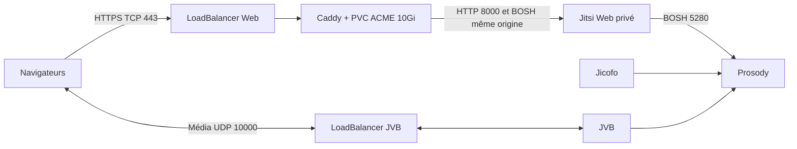

# Jitsi Meet sur Google Kubernetes Engine

Plateforme de visioconférence déployée avec Terraform, Kubernetes et Helm,
accessible en HTTPS via Caddy. Cette documentation distingue les observations
historiques des procédures et des validations récentes.

## Documentation

- [Vue d’ensemble](docs/README.md)
- [Rapport technique et preuves](docs/rapport.md)
- [Supervision JVB et Grafana](monitoring/README.md)

## Architecture



Adresse publique : https://jitsi-meet-m2.duckdns.org. Web : `34.78.71.58` ;
JVB : `34.62.165.81`. Caddy termine TLS, expose TCP 80/443 et conserve les
certificats sur un PVC indépendant de Helm. Aucun Ingress GKE n'est utilisé.
Les sondes internes et les contrôles JVB ne sont pas publiés par Caddy.
Le diagramme montre le chemin via le pont ; une réunion à deux peut utiliser P2P.

Le cluster comporte deux nœuds `e2-standard-2`. Dernières observations :
release `jitsi` révision 4, `jitsi-edge` révision 3 et cinq pods prêts.
Le chart applicatif communautaire `jitsi-contrib/jitsi-helm` est conservé en
version 3.10.0 ; le dossier historique `jitsi/` n'est pas le chart déployé.

## Validations

| Composant | Résultat |
|---|---|
| Déploiement Helm | OIDC, SOPS/KMS et mise à niveau contrôlée validés. [Run Helm](https://github.com/SaminouA/projet-jitsi-helm/actions/runs/44057014445) |
| Terraform | Plan et Apply approuvés. Le plan indépendant confirme zéro changement et un état GCS inchangé. [Apply](https://github.com/SaminouA/projet-jitsi-helm/actions/runs/44292386368) · [Convergence](https://github.com/SaminouA/projet-jitsi-helm/actions/runs/44293963177) |
| Malleus et Chaos Mesh | Pipelines manuels réussis. Le rapport conserve les résultats et leurs limites. [Preuves](docs/rapport.md#7-preuves-de-validation) |
| Monitoring | Collecte JVB via Managed Prometheus et 14 panneaux testés dans Grafana local. [Supervision](monitoring/README.md) |

Les déploiements automatiques Helm et Terraform sont désactivés. Les expériences restent manuelles et protégées.

## Organisation du dépôt

| Chemin | Usage |
|---|---|
| `terraform/` | Cluster, node pool et backend GCS ; states exclus de Git |
| `charts-officiels/jitsi-meet/` | Chart applicatif conservé |
| `charts/jitsi-edge/` | Proxy TLS Caddy |
| `charts/jitsi-load-test/` | Ressources temporaires Malleus/Selenium |
| `deploy/` | Profils HTTPS et stockage |
| `scripts/` | Validations, déploiement contrôlé, instrumentation et expériences |
| `.github/workflows/` | CI, CD Helm, Terraform contrôlé, builds et expérimentations manuelles |
| `tests/` | Tests statiques et synthèses expurgées ; collectes brutes ignorées |
| `docs/` | Index et rapport technique |

Le profil public associe `values-gke.yaml`, `deploy/jitsi-duckdns.yaml` et
`values-secrets.sops.yaml`. Les secrets sont chiffrés avec SOPS/KMS ; ne jamais
publier de déchiffrement, de state, de sauvegarde Helm ou de clé JSON.
Le profil localhost nécessite une surcharge explicite : un port-forward seul
ne transforme pas la configuration publique en profil localhost.

## Vérifications locales

Avec les dépendances du dépôt déjà installées :

```sh
sh scripts/validate.sh
python3 -m unittest discover -s tests -v
python3 scripts/check-docs.py
```

Ces contrôles ne déploient pas le cluster et ne prouvent pas une réunion.
La validation Terraform utilise une copie isolée et un backend désactivé.

## Limites, sécurité et coûts

La capacité maximale et la haute disponibilité restent à évaluer.
Les droits de déploiement et d'expérimentation sont vérifiés dans les
workflows protégés. Toute opération mutante requiert une autorisation.

Les nœuds GKE et leurs disques, la VM de travail, les load balancers, le PVC Caddy, les adresses publiques, le trafic, GCS, KMS et les métriques peuvent générer des frais. Le sous-domaine gratuit ne rend pas
GKE gratuit. Une désinstallation Helm ne supprime pas automatiquement le PVC
indépendant ni l'adresse réservée. Toute remise en service, expérience ou
suppression exige une autorisation et une vérification des ressources à conserver.
