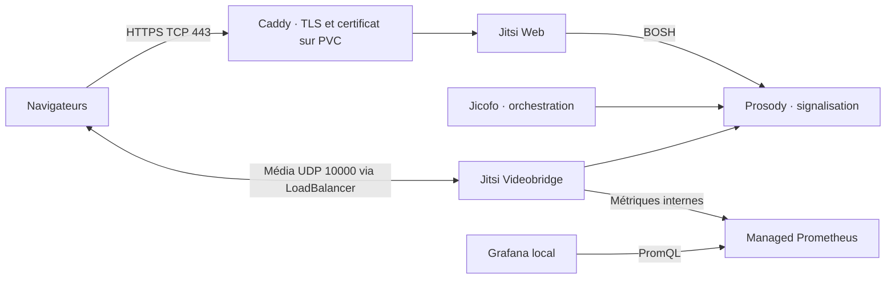

# Jitsi Meet sur Google Kubernetes Engine

Ce projet déploie une plateforme de visioconférence accessible en HTTPS sur un cluster GKE de deux nœuds. Il couvre le déploiement, la sécurisation, les tests vidéo, la reprise après une panne ciblée et la supervision. [Rapport technique et preuves](docs/rapport.md)

## Architecture et technologies



Terraform gère le cluster et son état distant dans GCS. Helm déploie le chart Jitsi Meet 3.10.0 et le chart Caddy. DuckDNS fournit le nom public et Caddy termine TLS. Une réunion à deux peut utiliser le mode pair à pair. GitHub Actions utilise OIDC pour s'authentifier auprès de Google Cloud, et SOPS/KMS protège les secrets de déploiement.

## Résultats

| Validation | Résultat observé |
|---|---|
| Helm et Terraform | Mise à niveau Helm validée avec OIDC et SOPS/KMS. Le plan Terraform indépendant a confirmé zéro changement après application. |
| Vidéo avec Selenium et Malleus | Deux participants et trois relevés montrant des échanges vidéo dans les deux sens sur 49,1 s. |
| Reprise avec Chaos Mesh | Après la suppression ciblée du pod Web, son remplaçant est redevenu Ready. L'expérience s'est déroulée sans réunion active. |
| Supervision | Les 19 requêtes des 14 panneaux Grafana renvoient des séries réelles couvrant les nœuds, les pods et le bridge Jitsi. |

Les résultats détaillés et les limites des essais figurent dans le rapport. [Preuves de validation](docs/rapport.md#7-preuves-de-validation)

## Supervision

Cloud Monitoring fournit les métriques GKE. Google Cloud Managed Service for Prometheus collecte celles de Jitsi Videobridge toutes les 30 secondes via un `PodMonitoring` ciblant le port interne 8080 et le chemin `/metrics`. Grafana OSS, installé sur la VM et lié à localhost, interroge le backend managé en PromQL via une source Prometheus avec authentification OAuth renouvelée automatiquement.

Le dashboard JSON est importé en sélectionnant la source **Managed Prometheus**. Ses 14 panneaux couvrent le CPU, la mémoire, le réseau, la readiness, les redémarrages, l'activité et la santé du bridge, ainsi que l'état de la collecte. Il s'ouvre sur les 15 dernières minutes et s'actualise toutes les 30 secondes. [Guide de supervision](monitoring/README.md) · [Dashboard JSON](monitoring/grafana-jitsi.json)

## Arborescence du projet

```text
.
├── .githooks/                   Contrôles Git locaux
├── .github/workflows/           Pipelines GitHub Actions
├── charts/
│   ├── jitsi-edge/              Chart Caddy
│   └── jitsi-load-test/         Chart Selenium et Malleus
├── charts-officiels/jitsi-meet/ Chart Jitsi Meet utilisé sur GKE
├── deploy/                      Profils HTTPS, stockage et manifestes de déploiement
├── docs/
│   ├── README.md                Index de la documentation
│   ├── images/                  Captures Grafana
│   └── rapport.md               Rapport technique et preuves
├── jitsi/                       Chart historique
├── monitoring/
│   ├── README.md                Guide de supervision
│   ├── grafana-jitsi.json       Dashboard Grafana
│   └── jvb-podmonitoring.yaml   Collecte des métriques JVB
├── scripts/                     Contrôles et outils d'exploitation
├── terraform/                   Configuration GKE et backend GCS
├── tests/                       Tests et résultats expurgés
└── values-*.yaml                Valeurs Helm, dont les secrets chiffrés
```
