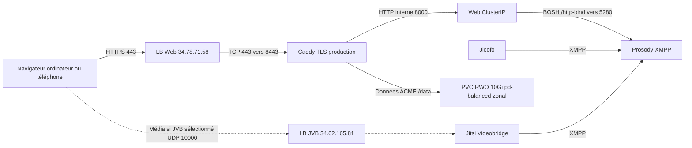
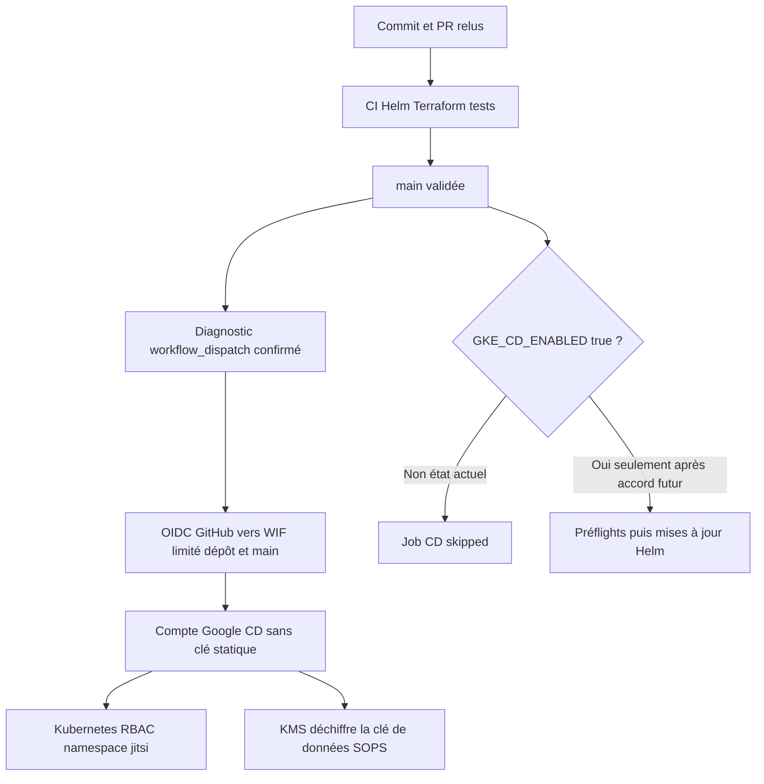

> Document historique conservé. Pour l’état consolidé du 17 novembre 2026,
> consulter le [rapport final](../rapport.md), les [preuves](../preuves/preuves-livraison.md)
> et le [plan oral final](../presentation-finale.md). Les statuts antérieurs ci-dessous
> ne décrivent pas nécessairement la version livrée.

# Architecture et périmètre réellement étudiés

État consolidé à partir des observations du 16 novembre 2026. Aucun nouveau
contrôle du cluster n'est effectué pendant cette finalisation locale.

Le LB Web publie TCP 80/443 ; 80 sert à la redirection et aux challenges ACME.
La sonde Caddy reste interne sur 8082. Web, Prosody et les contrôles JVB ne sont
pas exposés par le proxy. BOSH suit l'origine HTTPS du navigateur. Les domaines
XMPP internes ne sont pas des noms DNS publics à publier.

Le schéma média représente une route configurée, pas la preuve que le test à
deux l'a utilisée. Le test manuel ordinateur/téléphone confirme audio et vidéo
bidirectionnels ; il ne distingue pas P2P et JVB. TURN et WebSocket XMPP/Colibri
ne sont pas activés dans ce profil. Un réseau bloquant UDP peut rester limitant.

Le diagnostic vérifie sans mettre à jour les applications. La correction locale
vise un kubeconfig exec ADC : elle n'est pas encore validée sur GitHub. Les deux
diagnostics réels ont échoué sur whoami ; aucun déchiffrement SOPS runner ou CD
de bout en bout n'est déclaré réussi.

| Couche | Source du projet | Périmètre / limite |
|---|---|---|
| Projet/région | terraform/provider.tf | Identifiants codés en dur, pas des secrets |
| Cluster et pool | terraform/main.tf | Deux ressources Terraform, deux nœuds e2-standard-2, zone europe-west1-b |
| Réseau GCP | Valeurs GKE et ressources contrôlées par GKE | Pas de VPC ou firewall Terraform explicite dans ce dépôt ; réseau par défaut utilisé historiquement |
| Releases | Charts Jitsi et jitsi-edge | Jitsi révision 3, Caddy révision 2 lors des derniers contrôles |
| IP Web et PVC | Bootstrap opérateur autorisé | IP réservée indépendante et PVC non possédé par Helm |
| Secrets | values-secrets.sops.yaml | Chiffrement SOPS/KMS ; Secret Kubernetes n'est pas chiffré par le seul base64 |
| WIF/IAM/RBAC | Configuration cloud auditée et manifeste PVC reader | Tout n'est pas géré par Terraform ; ne pas présenter un provisionnement intégral automatisé |

Deux nœuds zonaux et une réplique Caddy/JVB ne constituent pas une haute
disponibilité validée. Recreate et disque RWO peuvent interrompre Caddy pendant
une mise à jour. Le PVC à politique Delete nécessite une décision séparée avant
suppression ; un rollback Helm conserve le PVC mais ne restaure pas son contenu.
