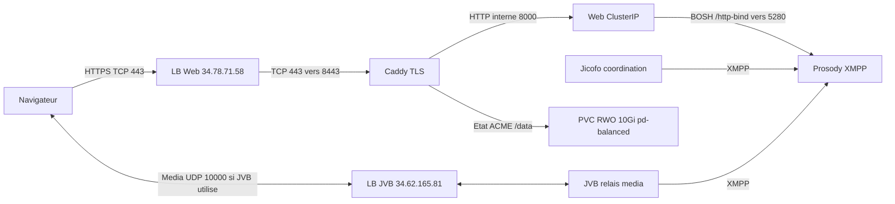
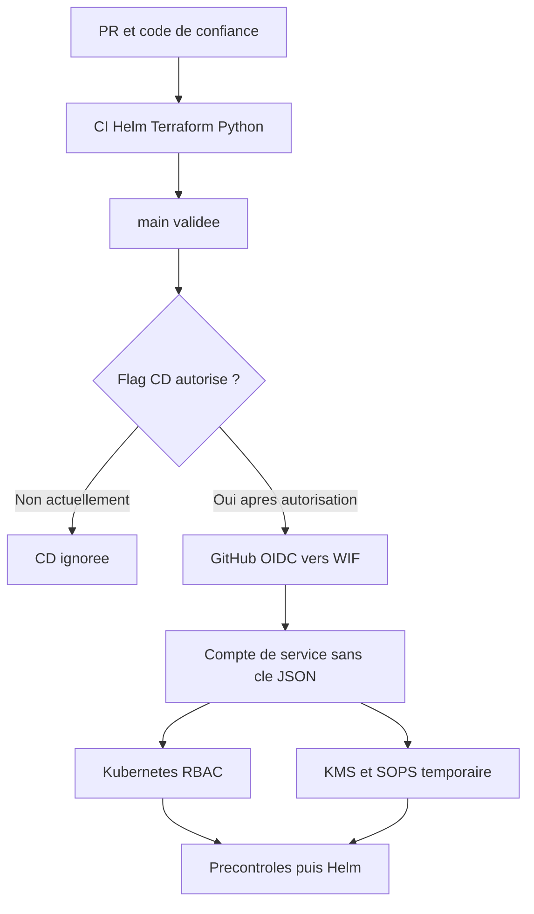

# Architecture de Jitsi Meet sur GKE

Architecture de référence de la livraison, consolidée à partir du rapport et
des configurations versionnées. Les observations citées datent du 17 novembre
2026 ; aucune nouvelle interrogation du cluster n'a été faite pour cette réorganisation.
L'[ancienne description du 16 novembre](architecture-2026-11-16.md)
est conservée pour la traçabilité.

Le LB Web expose TCP 80/443 ; HTTP redirige vers HTTPS et sert aux challenges
ACME. Caddy termine TLS puis transmet à Web. BOSH suit l'origine HTTPS du
navigateur ; l'HTTP interne vers Prosody n'est pas une URL publique.
Aucun Ingress GKE n'est utilisé. La sonde Caddy 8082, son administration et les
routes de contrôle JVB restent privées. XMPP/Colibri WebSocket et TURN ne sont
pas activés. Un réseau bloquant UDP peut empêcher le transport média.

Ce schéma représente les chemins configurés, pas une capture de trafic.
À deux participants, P2P est possible. Les preuves média JVB historiques sont
analysées dans le [rapport](../rapport.md), sans extrapolation de capacité.

| Couche | Source | Périmètre et limite |
|---|---|---|
| Cluster/pool | [main.tf](../../terraform/main.tf) | Deux ressources Terraform ; deux e2-standard-2 en europe-west1-b |
| État distant | [backend.tf](../../terraform/backend.tf) | GCS privé/versionné ; pas de state dans Git |
| Application | [chart Jitsi](../../charts-officiels/jitsi-meet/Chart.yaml) | Communautaire, version 3.10.0 ; dernière release attestée : révision 4 |
| HTTPS | [chart edge](../../charts/jitsi-edge/Chart.yaml) | Caddy ; dernière release attestée : révision 3 |
| Configuration réseau | [profil Jitsi](../../deploy/jitsi-duckdns.yaml), [profil edge](../../deploy/jitsi-edge-duckdns.yaml) | DNS DuckDNS vers le LB Web, IP JVB annoncée séparément ; adresses à relire après recréation |
| Stockage TLS | [PVC indépendant](../../deploy/jitsi-edge-storage.yaml) | 10Gi, RWO, Recreate ; supprimer le PVC peut supprimer le disque ; rollback sans restauration des données |
| Secrets | [fichier chiffré](../../values-secrets.sops.yaml) | SOPS/KMS ; base64 Kubernetes seul ne chiffre pas les secrets |
| Tests | [chart de charge](../../charts/jitsi-load-test/Chart.yaml) | Selenium ClusterIP + Job Malleus isolés ; aucune exposition publique supplémentaire |

Le diagnostic runner puis la CD Helm OIDC/SOPS ont réellement réussi le
17 novembre ; la dernière CD après fusion est skipped, avec flag désactivé.
Le Terraform readonly a réussi ; l'apply GitHub reste non exécuté et limité
par son garde à un label. Les nouveaux workflows Malleus/Chaos sont manuels,
validés statiquement et non exécutés. Ils exigent des prérequis dédiés encore absents.

Terraform ne gère pas tout IAM/WIF/RBAC, le PVC ni l'IP Web réservée. Un bootstrap
opérateur distinct reste nécessaire ; le CD Helm ne reconstruit pas seul un
cluster absent. Deux nœuds zonaux et une seule réplique Caddy/JVB ne constituent
pas une haute disponibilité démontrée.

Voir l'[index des preuves](preuves-livraison.md), les
[guides](sommaire-avant-simplification.md) et le [tableau de conformité](conformite-finale.md).
