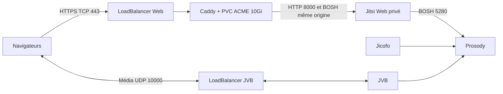

# Jitsi Meet sur GKE — Master 2 DevOps

Plateforme de visioconférence déployée avec Terraform, Kubernetes et Helm,
accessible en HTTPS via Caddy. Cette documentation distingue les observations
historiques des procédures et des pipelines non exécutés.

## Livraison du 18 novembre 2026

La navigation complète est dans le [sommaire documentaire](sommaire-avant-simplification.md).
Le rapport, la présentation et l’architecture restent à la racine de `docs/` ;
les procédures, preuves, contrôles de livraison et historiques sont séparés.

- [Rapport académique](../rapport.md)
- [Conformité, preuves et limites](conformite-finale.md)
- [Index des preuves vérifiables](preuves-livraison.md)
- [Plan de présentation orale](presentation-finale.md)
- [Journal technique conservé](rapport-avant-livraison-finale-2026-11-17.md)

Dernière base technique examinée : `23cb73d656015bbc71f16bb58abf308cb78d0fca`.
Les observations GKE datent du 17 novembre 2026 ; cette finalisation documentaire
ne constitue pas une nouvelle vérification de disponibilité du cluster.

## Architecture



Adresse publique : https://jitsi-meet-m2.duckdns.org. Web : `34.78.71.58` ;
JVB : `34.62.165.81`. Caddy termine TLS, expose TCP 80/443 et conserve les
certificats sur un PVC indépendant de Helm. Aucun Ingress GKE n'est utilisé.
Les sondes internes et les contrôles JVB ne sont pas publiés par Caddy.
Le diagramme montre le chemin via le pont ; une réunion à deux peut utiliser P2P.

Le cluster comporte deux nœuds `e2-standard-2`. Dernières observations :
release `jitsi` révision 4, `jitsi-edge` révision 3 et cinq pods prêts.
Le chart applicatif communautaire `jitsi-contrib/jitsi-helm` est conservé en
version 3.10.0 ; le dossier historique `jitsi/` n'est pas le chart déployé.

## Ce qui est réellement validé

| Élément | Preuve et portée |
|---|---|
| CI Helm, Terraform et Python | CI main réussie ; 138 tests sur la base technique examinée |
| CD Helm OIDC/SOPS | Exécution contrôlée réussie, puis désactivation du flag |
| Terraform distant | Migration GCS et readonly plan GitHub réussis ; aucun apply GitHub |
| Réunion manuelle | Audio/vidéo, chat et trois participants ; limites détaillées dans le rapport |
| Malleus/Selenium | Essais natifs puis vidéo GKE à deux participants, avec mesures RTP |
| Chaos Mesh | Une expérience historique pod-kill Web ; récupération HTTPS mesurée |
| Nouveaux workflows d'expérimentation | Reconnus par GitHub et validés statiquement, jamais exécutés |

Les flags de déploiement restent désactivés ; le flag d'expérimentation n'est
pas défini. Les limites de capacité et la haute disponibilité ne sont pas démontrées.

## Structure et procédures

| Chemin | Usage |
|---|---|
| `terraform/` | Cluster, node pool et backend GCS ; states exclus de Git |
| `charts-officiels/jitsi-meet/` | Chart applicatif conservé |
| `charts/jitsi-edge/` | Proxy TLS Caddy |
| `charts/jitsi-load-test/` | Ressources temporaires Malleus/Selenium |
| `deploy/` | Profils HTTPS et stockage |
| `scripts/` | Validations, déploiement contrôlé, instrumentation et expériences |
| `.github/workflows/` | CI, CD Helm, Terraform contrôlé, builds et expérimentations manuelles |
| `tests/` | Tests statiques et synthèses expurgées ; collectes brutes ignorées |
| `docs/` | Rapport, procédures, preuves et présentation |

Le profil public associe `values-gke.yaml`, `deploy/jitsi-duckdns.yaml` et
`values-secrets.sops.yaml`. Les secrets sont chiffrés avec SOPS/KMS ; ne jamais
publier de déchiffrement, de state, de sauvegarde Helm ou de clé JSON.
Le profil localhost nécessite une surcharge explicite : un port-forward seul
ne transforme pas la configuration publique en profil localhost.

Procédures : [HTTPS](https-duckdns.md),
[bootstrap](bootstrap-https-court.md),
[CD Helm contrôlée](validation-cd-controlee.md),
[Terraform plan/revue/apply](terraform-plan-apply-validation.md),
[expérimentations manuelles](pipelines-experiences-controlees.md),
[vidéo Kubernetes](test-video-helm-2x90.md),
[Chaos Web](chaos-web-controle.md).
Ces guides contiennent des commandes potentiellement mutantes : ils ne constituent
pas une autorisation de les exécuter.

## Vérifications locales

Avec les dépendances du dépôt déjà installées :

```sh
sh scripts/validate.sh
python3 -m unittest discover -s tests -v
python3 scripts/check-docs.py
```

Ces contrôles ne déploient pas le cluster et ne prouvent pas une réunion.
La validation Terraform utilise une copie isolée et un backend désactivé.

## Limites, sécurité et coûts

L'apply Terraform GitHub reste non exécuté ; l'environnement de revue et le
secret de transport du plan restent à configurer avant toute activation.
Les nouveaux workflows Malleus/Chaos demandent aussi leur identité et leur
environnement dédiés. Ne pas réutiliser sans contrôle les droits de production.

Deux VM, leurs disques, deux LoadBalancers, le PVC Caddy, l'adresse réservée,
le trafic et KMS peuvent générer des frais. Le sous-domaine gratuit ne rend pas
GKE gratuit. Une désinstallation Helm ne supprime pas automatiquement le PVC
indépendant ni l'adresse réservée. Toute remise en service, expérience ou
suppression exige une autorisation et une vérification des ressources à conserver.
