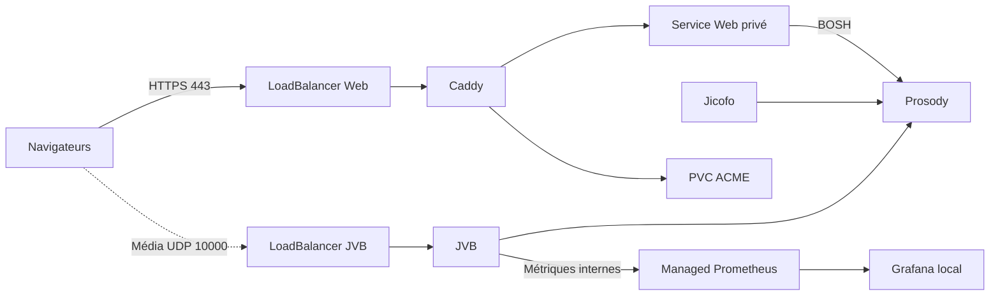

# Déploiement, automatisation, sécurisation et supervision de Jitsi Meet sur Google Cloud Platform

**Sup de Vinci – Bordeaux · Master 2 DevOps & Cloud Computing**
**Année scolaire 2026-2027 · Remise du 18 novembre 2026**

| Information | Valeur |
|---|---|
| Auteur | Amandine · nom de famille à compléter |
| Encadrant | À compléter |
| Dépôt | [SaminouA/projet-jitsi-helm](https://github.com/SaminouA/projet-jitsi-helm) |

## 1. Objectifs

Déployer un service Jitsi Meet accessible en HTTPS sur GKE, puis rendre sa
configuration reproductible et ses changements contrôlables depuis GitHub.
Le projet devait aussi démontrer une charge vidéo synthétique, la reconstruction
du pod Web après une panne injectée et l'observation de la plateforme.

Les neuf critères de la grille sont documentés en section 5. Les résultats
principaux sont le déploiement Helm réussi, un Plan et un Apply Terraform
protégés, les deux pipelines d'expérimentation réussis et la collecte JVB
vérifiée dans Managed Prometheus.

## 2. Architecture et choix techniques

Le cluster GKE comporte deux nœuds. Caddy termine TLS et conserve les données
ACME sur un volume persistant. Prosody assure la signalisation, Jicofo
coordonne les conférences et JVB relaie les médias lorsqu'il est utilisé.
Le namespace `jitsi-load-test` accueille les ressources temporaires de charge.

| Technologie | Rôle et raison du choix |
|---|---|
| Terraform et GCS | Déclarer le cluster et son pool, centraliser l'état et vérifier les changements avant application. |
| Kubernetes et Helm | Déployer Jitsi et Caddy de façon reproductible et isoler le cycle de vie de la charge. |
| Caddy et DuckDNS | Fournir un point d'accès HTTPS avec renouvellement ACME et un nom de démonstration stable. |
| GitHub Actions et OIDC | Automatiser les contrôles avec des identifiants temporaires et des approbations pour les opérations sensibles. |
| SOPS et Cloud KMS | Versionner les mots de passe XMPP chiffrés et les déchiffrer lors du déploiement autorisé. |
| Selenium, Malleus et Chaos Mesh | Générer des participants, observer la vidéo et injecter une faute ciblée. |
| Cloud Monitoring, Managed Prometheus et Grafana | Réutiliser la collecte GKE et visualiser l'infrastructure, la disponibilité des pods et l'activité JVB. |

## 3. Étapes de réalisation

1. **Provisionnement.** Définition du cluster et du pool dans Terraform, puis
   migration de l'état vers GCS. La CI valide les configurations.
2. **Déploiement.** Validation du profil local, puis mise en service de Jitsi
   derrière Caddy. Le pipeline Helm protégé utilise OIDC et SOPS/KMS.
3. **Expérimentations.** Validation manuelle approuvée du scénario Chaos Web avec
   le manifeste PodChaos, puis exécution de Malleus. Chaque workflow
   publie les observations et nettoie ses ressources temporaires.
4. **Validation Terraform.** La preuve d'Apply a ajouté uniquement le label
   GKE `devops-apply-proof=github-actions`. Le plan exact a été contrôlé par
   empreinte et approuvé. Aucun nœud ou cluster n'a été créé, détruit ou
   remplacé. Après l'Apply, les deux nœuds étaient prêts, les cinq pods Jitsi
   avaient les mêmes UID et aucun redémarrage, et HTTPS répondait 200.
   `TF_CD_ENABLED` est désactivé au dépôt et dans l'environnement protégé.
   Le Plan nº 8 confirme zéro changement et un état GCS inchangé.
5. **Supervision.** Un PodMonitoring cible les métriques internes JVB sur 8080.
   Les résultats et les procédures d'accès figurent dans le [guide monitoring](../monitoring/README.md).

## 4. Résultats, difficultés et limites

| Sujet | Résultat et limite |
|---|---|
| Malleus | Le run nº 8 configure deux participants et 90 s. Le Job termine en 2 min 58 s, démarrage et fin compris. Trois relevés sur 49,1 s montrent deux endpoints actifs et des échanges vidéo dans les deux sens. La continuité vidéo sur 90 s n'a pas été mesurée. Les cinq pods Jitsi restent stables. Le chart de charge est nettoyé. |
| Chaos Mesh | Une suppression ciblée du Web. Le nouveau pod possède un UID différent et revient Ready, tandis que les quatre autres gardent leurs UID. Le PodChaos est nettoyé. Aucune réunion active n'a été soumise à cette faute. |
| Monitoring | Deux collecteurs Managed Prometheus prêts, scrape et santé JVB à 1. Les 19 requêtes des 14 panneaux ont renvoyé des séries. Grafana OSS a été validé localement puis arrêté. Le débit JVB représente le RTP/RTCP agrégé. La preuve vidéo seule vient des navigateurs Malleus. |
| Réseau de charge | Namespace dédié et Selenium en ClusterIP sans IP externe. Aucun filtrage inter-namespace par NetworkPolicy n'a été démontré. La grille ne stipule pas ce filtrage. |

| Difficulté | Solution vérifiée |
|---|---|
| Passage de localhost à HTTPS | Profil public explicite, terminaison TLS Caddy et stockage ACME persistant. |
| Erreur d'autorisation du runner Chaos | Interrogation de SelfSubjectAccessReview avec l'identité effective. Les refus motivés et les erreurs d'évaluation sont traités distinctement. |
| Droits trop larges du contrôleur Chaos | Retrait du droit `pods/exec` inutile. La suppression reste limitée au seul nom du Web approuvé. |
| Première exécution Malleus interrompue | Retrait de la dépendance aux métriques des pods fraîchement créés. Le suivi du Job, la capacité des nœuds et la preuve vidéo ont été conservés. |
| Plan Terraform refusé en mode lecture seule | Ce mode exige un plan sans action. Le label a été appliqué via le mode protégé prévu pour ce changement, puis la convergence a été vérifiée séparément. |

Les tests couvrent les scénarios observés. La capacité maximale, la haute
disponibilité, TURN et la continuité d'une conférence pendant Chaos restent à
évaluer. Les relevés avant et après attestent l'état des composants à ces
instants. Les résultats vidéo sont échantillonnés et les débits ne constituent
pas une garantie de service.

## 5. Grille du professeur

| Nº | Critère | Résultat et preuve |
|---:|---|---|
| 1 | Chart Helm Jitsi | Validé. [Chart](../charts-officiels/jitsi-meet/Chart.yaml). |
| 2 | Chart Helm jitsi-meet-torture | Validé sous le nom [jitsi-load-test](../charts/jitsi-load-test/Chart.yaml). Il fournit Deployment et Service Selenium ainsi que le Job Malleus. |
| 3 | Code Terraform | Validé. [Cluster et pool](../terraform/main.tf), état distant GCS. |
| 4 | Secrets gérés par SOPS ou OpenBao | SOPS/KMS. [Valeurs chiffrées](../values-secrets.sops.yaml) et utilisation validée par le run Helm. Le contrôle ciblé ne couvre pas exhaustivement l'historique Git. |
| 5 | Dépôt organisé et documenté | [README](../README.md), [index documentaire](README.md), rapport et preuves. |
| 6 | Déploiement Helm ou ArgoCD passant | Voie Helm validée avec SOPS/KMS et OIDC. [Run 44057014445](https://github.com/SaminouA/projet-jitsi-helm/actions/runs/44057014445). |
| 7 | Provisionnement infra passant | [Plan et Apply nº 7](https://github.com/SaminouA/projet-jitsi-helm/actions/runs/44292386368) réussis. [Convergence nº 8](https://github.com/SaminouA/projet-jitsi-helm/actions/runs/44293963177) à zéro changement. |
| 8 | Pipeline Malleus dédié et passant | [Run nº 8](https://github.com/SaminouA/projet-jitsi-helm/actions/runs/44284381205) réussi. |
| 9 | Pipeline Chaos Mesh dédié et passant | [Run 44282191029](https://github.com/SaminouA/projet-jitsi-helm/actions/runs/44282191029) réussi. |

## 6. Conclusion et perspectives

Le projet a livré Jitsi sur GKE avec HTTPS, déploiement contrôlé et secrets
chiffrés. Les pipelines validés attestent la convergence Terraform, une charge
vidéo à deux participants et la reconstruction du Web après suppression.
Le monitoring fournit des mesures réelles pour étudier ces scénarios.

Le **bonus proposé par le professeur** reste une perspective **non réalisée**.
Il consisterait à déployer une architecture multicloud actif/passif, à gérer
le DNS Cloudflare avec Terraform et à sélectionner le fournisseur actif via
une variable du pipeline. Il resterait à tester le basculement et la reprise.

## 7. Annexes et sources de preuve

- [Index des preuves](preuves-livraison.md) et [rapport détaillé conservé au commit 4452c17](https://github.com/SaminouA/projet-jitsi-helm/blob/4452c171a987f61933fbc7e013ecbb940a3505b1/docs/rapport.md).
- [Artefact Malleus](https://github.com/SaminouA/projet-jitsi-helm/actions/runs/44284381205/artifacts/14418602142) et [artefact Chaos](https://github.com/SaminouA/projet-jitsi-helm/actions/runs/44282191029/artifacts/14416963978), également sauvegardés hors Git.
- [Monitoring](../monitoring/README.md), manifeste JVB et dashboard Grafana.
- [Journal historique](archives/rapport-avant-livraison-finale-2026-11-17.md) et [procédure Terraform](terraform-plan-apply-validation.md).

Les éléments utiles de la branche documentaire historique sont la navigation,
les preuves et le contexte des premiers essais. La navigation a été reprise
dans l'index. Le premier diagnostic IAM avait buté sur le droit
`serviceusage.services.enable`. L'audit a distingué l'identité gcloud des
identifiants ADC. Les compteurs cumulés JVB du premier palier sont restés
stables entre deux relevés et ne mesurent donc pas le volume de l'intervalle.
Le [complément historique](https://github.com/SaminouA/projet-jitsi-helm/blob/3521f81c0f6ca6d8eebe5c4a70570168c1415281/docs/rapport.md)
est aussi conservé dans le bundle de remise.

Les ressources GCP maintenues pour la démonstration peuvent générer des coûts.
Elles comprennent le cluster et ses deux nœuds, la VM de travail, les disques
dont le PVC ACME, les load balancers et adresses publiques, GCS, KMS, le trafic,
les logs et l'ingestion Managed Prometheus. Aucun montant de facture n'a été vérifié.
