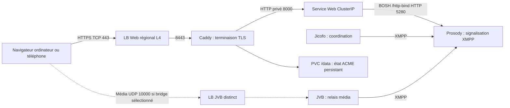

# Déploiement et automatisation d'une plateforme de visioconférence Jitsi Meet sur Google Cloud Platform (GCP)

**Rapport de projet — Master 2 — DevOps & Cloud Computing**
**Remise prévue : 18 novembre 2026 — consolidation documentaire : 17 novembre 2026**

| Information académique | Valeur |
|---|---|
| Auteur | Amandine — nom de famille : À compléter |
| Établissement | Sup de Vinci Bordeaux |
| Formation | Master 2 — DevOps & Cloud Computing |
| Enseignant ou encadrant | À compléter |
| Année universitaire | 2026-2027 |
| Dépôt | [SaminouA/projet-jitsi-helm](https://github.com/SaminouA/projet-jitsi-helm) |
| Référence technique relue | `main` au commit `23cb73d656015bbc71f16bb58abf308cb78d0fca` |

## Résumé

Ce projet porte sur la mise en place d'une plateforme Jitsi Meet dans un
cluster Google Kubernetes Engine. Terraform décrit le cluster et son pool ;
Helm assemble les composants ; GitHub Actions contrôle les configurations et
prépare leur livraison. La démarche associe déploiement, diagnostic réseau,
sécurisation des identités et observation expérimentale.

Les essais ont établi le fonctionnement des réunions, un accès public HTTPS,
un déploiement Helm contrôlé depuis GitHub, le chiffrement SOPS/KMS et un plan
Terraform distant en lecture seule. Des campagnes Malleus/Selenium ont produit
de l'audio puis de la vidéo synthétiques. Un essai Kubernetes a d'abord été
arrêté par sécurité, puis un profil CPU corrigé a abouti. Une expérience Chaos
Mesh limitée au Web a mesuré sa récupération, avec une interruption HTTP réelle.

Ces résultats restent ceux d'un environnement pédagogique de deux nœuds et
d'essais courts. Ils ne démontrent ni une capacité maximale ni une haute
disponibilité. **L'apply Terraform GitHub et les nouveaux workflows de charge
et de chaos n'ont pas été exécutés.** Leur code intégré et leurs validations
statiques sont distingués des opérations réellement accomplies.

## Guide de lecture et statut des preuves

Ce document remplace la présentation cumulative du journal par une synthèse
chronologique. Le [journal intégral antérieur](archives/rapport-avant-livraison-finale-2026-11-17.md)
conserve les commandes, états intermédiaires, échecs et préparations dans leur
contexte historique. Il ne constitue pas la procédure actuelle à rejouer.
L'[index des preuves](preuves-livraison.md) relie les résultats aux fichiers,
commits et exécutions GitHub. Les journaux bruts et sauvegardes sensibles restent
locaux, hors Git.

Quatre qualifications sont utilisées : **exécuté** pour une opération attestée,
**observé** pour un résultat utilisateur ou une mesure, **validé statiquement**
pour du code ou un rendu contrôlé sans déploiement, et **préparé, non exécuté**
pour un futur pipeline. Une CI réussie ne constitue pas une preuve de réunion.
Les états du cluster mentionnés ci-dessous sont datés des essais ; la rédaction
n'a pas effectué de nouvelle interrogation GCP ni de nouveau test média.

Plan : 1. Besoin ; 2. Technologies ; 3. Architecture ; 4. Infrastructure ;
5. Déploiement et réseau ; 6. Identités et secrets ; 7. CI/CD ;
8. Validations fonctionnelles ; 9. Performance ; 10. Résilience ;
11. Incidents et analyse ; 12. Conformité ; 13. Conclusion ; annexes.

## 1. Besoin, problématique et méthode

Une plateforme de visioconférence combine une interface, de la signalisation
et des flux média sensibles au réseau et aux ressources. Voir une page Web ou
un pod Running ne suffit donc pas pour conclure au fonctionnement d'une réunion.
La problématique retenue est : **comment déployer Jitsi de façon reproductible
sur GKE, sécuriser ses évolutions et apporter des preuves de fonctionnement
et de comportement sous une charge limitée ?**

Le projet avait déjà commencé : l'étude a repris ses fichiers, son chart et
ses branches, sans remplacer l'installation par une autre solution. Une première
destruction volontaire du cluster avait limité les coûts ; le cluster a ensuite
été recréé pour les essais. La transcription complète du provisionnement initial
n'est pas conservée : les observations ultérieures et les ressources Terraform
ne doivent pas être présentées comme un journal exhaustif d'apply.

La progression a été la suivante : audit de l'existant, corrections hors cloud,
contrôles statiques, déploiement, accès local puis HTTPS, sécurisation, CD Helm,
essais fonctionnels et média, expérience de panne, backend Terraform distant,
puis préparation des nouveaux pipelines. Chaque opération de mutation avait
un périmètre distinct ; un diagnostic réussi ne valait pas accord de déploiement.

## 2. Technologies : rôle, choix et usage concret

| Technologie | Rôle et raison du choix dans ce projet | Utilisation effective |
|---|---|---|
| GCP | Réunir calcul, réseau, stockage, IAM et KMS dans le cadre cloud du projet | Projet pédagogique, GKE, deux LB, disque ACME, bucket d'état et clé KMS |
| GKE | Utiliser Kubernetes managé pour concentrer le travail sur l'application et son exploitation | Cluster zonal `jitsi-cluster`, deux nœuds `e2-standard-2` |
| Docker | Emballer outils et dépendances dans des images reproductibles | Images Jitsi réutilisées ; images Selenium et Malleus construites et publiées sur GHCR |
| Kubernetes | Orchestrer pods, sondes, Services, stockage et contrôles d'accès | Deployments Web/Jicofo/JVB/Caddy, StatefulSet Prosody, PVC et RBAC |
| Terraform | Décrire les ressources et examiner un plan avant mutation | Cluster/pool, état migré vers GCS ; nouveau label de preuve encore non appliqué |
| Helm | Paramétrer les manifests et suivre les révisions de release | Chart communautaire Jitsi, complément Caddy, chart de test isolé |
| Git et GitHub | Tracer configurations, correctifs et preuves ; intégrer par PR | Branches conservées, contrôle requis et fusions auditables |
| GitHub Actions | Reproduire les contrôles et encadrer les opérations distantes | CI, CD Helm réussie une fois, builds d'images réussis, nouveaux pipelines manuels préparés |
| OIDC/WIF et ADC | Obtenir une identité Google temporaire sans clé privée de compte de service | Comptes Helm et Terraform séparés ; kubeconfig exec ADC |
| SOPS/KMS | Versionner des valeurs chiffrées et contrôler leur déchiffrement | Mots de passe XMPP Jicofo/JVB, comparaison aux Secrets sans affichage |
| Malleus/Selenium | Créer des participants WebRTC et observer leurs médias | Tests synthétiques à deux et trois participants, dont un scénario Kubernetes réussi |
| Chaos Mesh | Introduire une faute définie pour mesurer la récupération | Une suppression du seul pod Web, contrôleur minimal temporaire, nettoyage attesté |

Une image n'est pas un conteneur : l'image est l'artefact distribué, le
conteneur est son instance d'exécution. Docker sert ici à construire les
images de test ; **containerd**, observé sur GKE, exécute les conteneurs du
cluster. La présence de Docker sur la VM ne fait pas de Docker Engine le
runtime de GKE.

Le chart applicatif local est issu de **jitsi-contrib/jitsi-helm**, version
3.10.0, application `stable-11248`. Le nom `charts-officiels/` ne constitue pas
une certification d'éditeur. Le dossier `jitsi/` est un ancien squelette Nginx,
conservé mais non utilisé pour cette installation. Le projet n'a pas modifié
le code métier de Jitsi.

| Outil ou composant | Version utilisée ou observée |
|---|---|
| Terraform / provider Google verrouillé | 1.16.6 / 7.46.1 |
| Helm dans les contrôles | 3.22.1 |
| Chart Jitsi / application | 3.10.0 / stable-11248 |
| Chart Caddy / application | 0.1.0 / 2.11.9 |
| SOPS | 3.11.0 |
| Python CI / PyYAML | 3.12 / 6.0.3 |
| Selenium Grid / Chaos Mesh | 4.26.0 / 2.8.8 |
| Jitsi Meet Torture | Commit `4c00915e97006ff2224bb509eb3582bf3a10ca85` |
| Kubernetes observé pendant les diagnostics | v1.36.4-gke.2377000 |

Ce tableau décrit l'environnement étudié, pas une recommandation de versions
actuelles. Le verrouillage facilite la reproduction ; il ne dispense pas d'une
maintenance de sécurité, notamment pour les navigateurs de test anciens.

## 3. Architecture finale et responsabilités

### 3.1. Chemins applicatifs



Ce schéma est une représentation des charts et des ressources observées,
pas une capture de trafic. Web sert l'interface et relaie BOSH ; Prosody assure
la signalisation XMPP ; Jicofo coordonne les conférences ; JVB relaie les médias.
Les flux média ne traversent pas nécessairement le reverse proxy Web.
[Architecture Jitsi](https://jitsi.github.io/handbook/docs/architecture/).

| Paramètre | Valeur observée ou versionnée |
|---|---|
| Projet / zone | `project-fcf2ef91-c005-4910-a10` / `europe-west1-b` |
| Cluster / pool | `jitsi-cluster` / `jitsi-node-pool` |
| Releases / namespace applicatif | `jitsi`, `jitsi-edge` / `jitsi` |
| Domaine public | `jitsi-meet-m2.duckdns.org` |
| IP Web réservée / nom de réservation | `34.78.71.58` / `jitsi-edge-ip` |
| IP publique JVB | `34.62.165.81`, UDP 10000 |
| Web interne / Prosody BOSH | 8000 / 5280 |
| Dernières révisions applicatives attestées le 17 novembre | Jitsi 4, Caddy 3, cinq pods prêts |
| Stockage Caddy | PVC `jitsi-edge-data`, 10 Gi, `standard-rwo`, RWO, disque `pd-balanced` zonal |

Les adresses sont des valeurs de l'expérience, à relire après toute recréation.
Un sous-domaine gratuit a évité l'achat d'un domaine ; il ne rend pas gratuits
les ressources GCP ou le trafic. Aucun Ingress n'est déployé : le LB L4 transmet
TCP et Caddy termine TLS. HTTP 80 sert à la redirection et aux challenges ACME.
Les ports internes Caddy sont 8080/8443 ; la sonde 8082 reste privée.

La configuration BOSH suit explicitement l'origine du navigateur :

```javascript
config.bosh = window.location.origin + '/http-bind';
```

Avec `publicURL=https://jitsi-meet-m2.duckdns.org`, le navigateur utilise donc
HTTPS pour BOSH ; l'HTTP entre Caddy, Web et Prosody reste interne. L'exception
HTTP de localhost utilisée au début n'est pas une stratégie de publication
publique. Les domaines XMPP internes ne nécessitent pas d'enregistrement DNS public.

Web reste ClusterIP ; XMPP et Colibri WebSocket ne sont pas publiés dans ce
profil. Caddy désactive son administration et HTTP/3, et refuse les routes
`/metrics`, `/colibri/stats`, `/colibri-ws`, `/debug`, `/healthz` et `/about/health`.
TURN n'est pas activé. Un réseau bloquant UDP peut donc rester limitant.

Avec deux participants, P2P est possible. L'essai utilisateur à deux ne prouve
pas le passage par JVB. Les tests Malleus ont désactivé P2P dans les seuls
clients de test ; ils ont corrélé clients et bridge. Trois participants passent
normalement par JVB, mais cette attente doit toujours être confrontée aux mesures.

### 3.2. Périmètre d'Infrastructure as Code

Terraform gère **deux ressources**, le cluster et son pool. Les Services
LoadBalancer déclenchent des ressources réseau gérées par GKE. L'IP Web, le PVC,
KMS, WIF/IAM, RBAC et le bucket ont été préparés ou créés par des procédures
opérateur séparées. Le dépôt n'est donc pas un provisionnement intégral de tout
le projet GCP depuis un seul apply.

Une seule réplique Caddy et un volume RWO avec stratégie Recreate simplifient
la persistance ACME, au prix d'une interruption possible pendant une mise à jour.
Le PVC est indépendant de la release Helm. Sa classe avait une politique Delete :
supprimer explicitement le PVC peut supprimer le disque. Un rollback Helm ne
restaure ni le contenu du volume ni une sauvegarde des certificats.

## 4. Préparation et évolution de l'infrastructure Terraform

### 4.1. Provisionnement initial et authentification

Les contrôles initiaux ont trouvé un état vide et un plan de deux créations.
Les quotas consultés laissaient une marge pour quatre vCPU E2 et deux disques
de nœud de 30 Go. Ce sont des instantanés historiques, pas une garantie de quota
ou de capacité actuelle. Les observations suivantes ont confirmé deux nœuds Ready.

Un incident a montré que `gcloud auth` et les ADC Terraform sont deux mécanismes
distincts. Sans ADC utilisateur ni variable de credentials, Terraform utilisait
le compte de la VM via metadata. L'authentification ADC de l'opératrice a corrigé
l'identité utilisée pour les contrôles, sans afficher de jeton. L'état final du
rôle minimal du compte Compute des nœuds n'a pas de justificatif IAM complet
conservé ; il n'est pas déduit du seul succès des pods.

`terraform/main.tf` décrit un cluster zonal sans pool par défaut permanent,
puis deux nœuds `e2-standard-2` avec disques `pd-balanced` de 30 Go. Le code final
contient `prevent_destroy=true` sur cluster et pool. Il conserve cependant
`deletion_protection=false` : la garde Terraform n'est pas une protection API
absolue contre un autre outil ou un changement du code.

### 4.2. Migration contrôlée de l'état vers GCS

Le 17 novembre, un bootstrap autorisé a créé un bucket Standard régional privé,
le compte Terraform sans clé et le provider WIF dédié. Versioning, accès uniforme,
prévention publique et permissions bucket ont été vérifiés. Le rôle cluster
n'accorde pas Owner/Editor ; la permission de mise à jour reste néanmoins plus
large qu'un seul label et nécessite le garde logiciel.

L'état local a ensuite été sauvegardé et migré, après comparaison des ressources,
vers `gs://project-fcf2ef91-c005-4910-a10-tfstate/jitsi/gke/default.tfstate`.
Le workspace est `default`, le lineage est resté identique sans être publié,
et le serial est passé de 9 à 10. Deux ressources, attributs, identifiants et
outputs identiques ont été contrôlés. Le plan de vérification de cette migration
était sans changement ; l'état distant n'a pas changé pendant ce plan.
La [preuve de migration](terraform-migration-resultats.json) distingue transfert
de l'état et mutation d'infrastructure. Le fichier local ancien est une
sauvegarde, pas une autorité concurrente à réutiliser pour apply.

Le bloc `backend "gcs" {}` est versionné, tandis que bucket et préfixe sont
fournis à l'initialisation contrôlée. Les contrôles CI utilisent une copie avec
`init -backend=false` et ne lisent pas le backend du projet.

### 4.3. Diagnostic readonly GitHub réellement réussi

Le diagnostic a d'abord échoué sur le sujet OIDC, puis sur un droit de lecture
Compute nécessaire au provider. Après corrections ciblées, le
[run 44116737677](https://github.com/SaminouA/projet-jitsi-helm/actions/runs/44116737677)
a réussi sur le commit `a5053689f79cb89e8706cc34b0112509b97e7fb5`, après approbation
manuelle. Il atteste OIDC sans clé, identité Terraform, GCS, validate et un plan
**0 create, 0 update, 0 delete, 0 replace**, avec état distant inchangé.
La [synthèse expurgée](terraform-github-plan-final.json) est la preuve structurée.
L'ancien journal s'arrêtait à l'attente d'approbation ; ce statut n'est plus
le résultat final du run.

Un autre plan, calculé avec les ADC de l'opératrice sur une copie privée,
prévoit **un update du seul label de preuve, aucune création, destruction ou
substitution, pool inchangé**. Il correspond à la configuration préparée dans
la PR nº 7, intégrée ensuite, et ne doit pas être confondu avec le plan readonly
sans changement de la version antérieure.

### 4.4. Apply contrôlé préparé, non exécuté

Le workflow actuel est manuel. Le mode readonly conserve une exigence zéro
différence. Comme `terraform/main.tf` contient désormais le label
`devops-apply-proof=github-actions` encore non appliqué, une future exécution peut
présenter ce changement et être refusée par ce mode strict. Ce refus ne déclenche
jamais d'apply et n'invalide pas la réussite historique sur l'ancien commit.

Le mode préparé `apply-label` suit le DAG :

```text
apply-preflight -> prepare-plan -> review-plan -> apply
```

Le plan est généré et vérifié avant sa revue. Le résumé exhaustif des seuls
changements permis et le SHA-256 du binaire sont publiés. Le job `review-plan`
attend une approbation dans un environnement distinct, `terraform-apply-review`,
sans droit OIDC. L'apply télécharge l'ID immuable d'artefact de ce run et vérifie
empreinte, HMAC, commit, run/attempt, digest revu et égalité de l'état distant.
Aucun nouveau plan n'est calculé avant application ; un plan final de vérification
est prévu après celle-ci.

Le binaire et l'état de référence ne transitent qu'en paquet chiffré et authentifié
(AES-256-CBC/PBKDF2 puis HMAC-SHA256 avec clé séparée). Le secret GitHub privé
`TF_PLAN_TRANSPORT_KEY` et l'environnement de revue restent à provisionner après
accord. Le transport entre vrais runners, la revue et l'apply n'ont pas été
exécutés. Les tests cryptographiques utilisent des données synthétiques.
Ce secret de transport n'est pas une clé JSON de compte de service et ne remplace
pas le chiffrement SOPS/KMS des secrets applicatifs.

## 5. Déploiement Jitsi : de localhost à HTTPS

### 5.1. Phase localhost et annonce du bridge

L'interface initiale était accessible, mais la connexion aux réunions était
bloquée. Les valeurs inspectées contenaient une URL sans protocole et un JVB
non exposé de façon adaptée. Leur correction ne permet pas d'attribuer tout
l'échec ancien à une cause unique, faute de journal complet.

La première release GKE a servi à obtenir l'IP du LoadBalancer JVB. Le script
`jvb-values.py` a ensuite généré l'overlay de cette IP, validé avec la base,
puis une seconde mise à jour Helm a donné la révision 2. L'annonce
`JVB_ADVERTISE_IPS` correspondait à l'IP réelle du Service, UDP 10000.
Le Web restait privé, accessible par `kubectl port-forward` TCP `8081:8000`
et transfert VS Code Remote SSH vers Windows.

Le transfert VS Code initial acceptait TCP mais ne retournait aucune réponse
HTTP. La VM répondait HTTP 200 et le Service possédait un endpoint. Supprimer
et recréer uniquement le transfert VS Code a rétabli l'accès, sans redémarrer
les pods ni modifier les clés SSH. La séparation des deux tunnels a permis de
localiser le problème hors du déploiement applicatif.

### 5.2. Bootstrap Caddy et validation TLS

Le 16 novembre, une IP régionale, un PVC 10 Gi et la release `jitsi-edge` ont
été créés après autorisation. Une première commande d'adresse régionale utilisait
à tort `--ip-version=IPV4` ; elle a échoué sans création et la reprise corrigée
n'a été faite qu'après accord. Le PVC a été Pending avec WaitForFirstConsumer,
puis Bound lors du placement du premier pod : ce comportement était normal.

Le DNS DuckDNS, modifié par l'utilisatrice, a convergé vers l'IP Web. Les premiers
challenges ACME avaient encore rencontré l'ancienne adresse ; l'émission staging
s'est ensuite achevée. Son certificat n'était pas reconnu par la confiance système,
ce qui est attendu. Un magasin staging temporaire a permis de vérifier la chaîne
sans installer de racine système ni utiliser `curl -k`.

La bascule production a donné la révision edge 2. Un timeout de challenge a été
observé, puis Caddy a convergé sans modification réseau supplémentaire. Le
certificat a été validé avec le nom DNS et le magasin système : du 16 novembre
2026 18:30:15 UTC au 14 février 2027 18:30:14 UTC lors du contrôle. La redirection
HTTP était 308, l'accès HTTPS 200 et les routes privées 404. Le renouvellement
futur et la restauration ACME après perte du disque ne sont pas démontrés.

### 5.3. Migration publique et continuité des paramètres

La migration Jitsi a changé seulement `publicURL`, avec sauvegardes privées,
`--reuse-values` et comparaison en mémoire ; la release est devenue révision 3.
La ConfigMap commune n'étant pas couverte par un checksum de rollout du chart,
des rollouts successifs ont été nécessaires pour recharger les variables.
Les readiness temporaires ont échoué pendant certains démarrages, puis les
composants sont devenus prêts. Secrets, PVC et IP sont restés inchangés.

Le profil versionné actuel est `values-gke.yaml` public, complété pour cette
installation par `deploy/jitsi-duckdns.yaml` et les valeurs sensibles déchiffrées
uniquement en zone privée. Le profil Caddy réel est
`deploy/jitsi-edge-duckdns.yaml`, en production ; le chart générique reste staging
par défaut. Un simple port-forward ne rétablit pas un profil localhost après
cette migration : la configuration servie reste publique tant qu'elle n'est
pas modifiée. Le contrôle local garde une régression localhost explicite.

## 6. Identités, droits et secrets

### 6.1. Authentification et autorisation sont distinctes

OIDC permet au runner de présenter une identité temporaire à WIF ; le compte
Google ainsi obtenu reçoit ses droits IAM. L'accès à Kubernetes passe ensuite
par le plugin GKE et les ADC, puis par RBAC. Lire le cluster avec IAM n'autorise
pas automatiquement une création Kubernetes. Le compte Google est représenté
par un sujet Kubernetes `User`, différent d'un ServiceAccount Kubernetes.
[WIF pour les pipelines](https://docs.cloud.google.com/iam/docs/workload-identity-federation-with-deployment-pipelines).

| Identité | Périmètre constaté ou prévu | Statut |
|---|---|---|
| Opératrice / ADC | Provisionnement et contrôles autorisés | Utilisée historiquement, aucun jeton publié |
| Compte des nœuds Compute | Exécution des workloads GKE | Configuration observée ; justificatif IAM final incomplet |
| `github-jitsi-deployer` | Lecture GKE, déchiffrement KMS et RBAC applicatif dans `jitsi` | Diagnostic puis CD réellement réussis |
| `terraform-jitsi-deployer` | Rôle cluster et accès au seul bucket d'état ; pas de KMS/RBAC applicatif | Diagnostic readonly réellement réussi |
| `github-jitsi-experiments` | Identité séparée pour les futures expériences | Proposée dans le code, non provisionnée au dernier audit |

Le provider Helm est limité au dépôt et à main. Le provider Terraform ajoute
les identifiants immuables du dépôt/propriétaire, le chemin exact
`terraform-gke.yml` et le sujet de l'environnement `terraform-controlled`.
Le droit `compute.instanceGroupManagers.list`, nécessaire à la lecture du pool,
a été ajouté de façon ciblée après diagnostic, sans rôle Compute Admin.
Le droit `container.clusters.update` reste plus large qu'une mutation de label :
la restriction de champ dépend du code de confiance et du garde de plan.

Les règles de main imposent une PR et `Validation Helm`, avec refus des suppressions
et des pushes non fast-forward. Elles n'imposaient pas de seconde approbation
humaine de code. L'environnement Terraform imposait un reviewer et interdisait
le bypass, avec auto-revue par la personne déclenchante autorisée pour le diagnostic.
Cela ne démontre pas une séparation des tâches entre deux personnes.

### 6.2. Sécurisation des secrets avec SOPS et Google Cloud KMS

Les Secrets Kubernetes Jicofo/JVB contiennent leurs mots de passe XMPP internes.
L'analyse du chart a montré l'ordre : valeur explicite, Secret existant via
`lookup`, puis génération aléatoire. Un rendu hors cluster ne prouve pas la
reprise du Secret déjà installé. Le simple base64 d'un Secret Kubernetes ne
constitue pas une protection suffisante pour le publier.

Le 16 novembre, l'API KMS a été activée, puis `jitsi-sops-keyring` et la clé
`jitsi-sops-key` créés en `europe-west1`. SOPS 3.11.0 a chiffré
`jicofo.xmpp.password` et `jvb.xmpp.password` dans `values-secrets.sops.yaml`.
Le chiffrement/déchiffrement et l'égalité avec les Secrets existants ont été
confirmés sans affichage. Le commit `0069f65` versionne ce fichier chiffré et
l'exclusion du temporaire en clair.

SOPS chiffre les valeurs et KMS protège la clé de données par enveloppe ; la
référence KMS dans le YAML n'est pas la clé privée. Helm ne déchiffre pas SOPS
nativement. Dans le pipeline, le fichier déchiffré est temporaire, privé et
supprimé ; aucune sortie brute, artefact ou cache ne doit le conserver.
[Documentation SOPS](https://getsops.io/docs/).

Le diagnostic puis la CD ont effectivement validé le déchiffrement depuis le
runner. Les comparaisons après CD confirment l'absence de rotation Jicofo/JVB.
Le fichier en clair, ADC, kubeconfigs, clés, sauvegardes Helm, états/plans et
résultats bruts restent ignorés. `.gitignore` n'est ni un chiffrement local ni
une garantie contre un ajout forcé. La politique de chiffrement au repos des
Secrets Kubernetes n'est pas démontrée par le seul fichier SOPS.

## 7. Git, CI et livraison contrôlée

### 7.1. Contrôles et intégration

Git conserve la chronologie des corrections et des preuves ; les PR permettent
leur revue et leur validation avant intégration. `helm-ci.yml` exécute lint et
rendu Helm, invariants Web/BOSH/JVB, validation Caddy, tests Python, format et
validate Terraform sur copie temporaire sans backend. Les hooks appellent le
même script statique. La CI n'obtient pas d'identifiants GCP et ne déploie rien.

Les actions cloud/de livraison sont épinglées par SHA ; la CI historique utilise
encore certains tags majeurs. Le groupe `deploy-jitsi-gke-main` sérialise les
workflows opérationnels sans annuler le run actif. Les scripts refusent un main
qui a avancé ou un checkout qui ne correspond pas au SHA validé.

| Workflow | Déclenchement | Résultat attesté à la livraison |
|---|---|---|
| `helm-ci.yml` | Push, PR vers main, manuel | CI réussie sur `23cb73d` |
| `diagnose-gke.yml` | Manuel confirmé | Diagnostic réel réussi : identité, 49 droits, PVC, SOPS et disponibilité |
| `deploy-gke.yml` | Fin de CI push main réussie, flag général requis | Un essai CD réussi ; dernier job skipped avec flag false |
| `build-selenium.yml` | Manuel sur main | Image corrigée publiée après test caméra/microphone réussi |
| `build-malleus.yml` | Manuel sur main | Image publiée après exécution hors réseau à zéro participant |
| `terraform-gke.yml` | Manuel sur main | Readonly historique réussi ; nouveaux jobs de plan/revue/apply non exécutés |
| `malleus-controlled.yml` | Manuel, flags et revue requis | Définition corrigée et reconnue ; aucune exécution réelle |
| `chaos-controlled.yml` | Manuel, flags et revue requis | Définition corrigée et reconnue ; aucune exécution réelle |

### 7.2. Première CD Helm effectivement réussie

Une relance autorisée de la CI push main a déclenché le
[run CD 44057014445](https://github.com/SaminouA/projet-jitsi-helm/actions/runs/44057014445).
OIDC, exec ADC, RBAC, KMS/SOPS, précontrôles, upgrades et nettoyages ont réussi.
Jitsi est passé de révision **3 à 4**, Caddy de **2 à 3**. Les cinq pods étaient
prêts sans redémarrage, et les IP, PVC et Secrets sont restés identiques.
Le flag général a été remis à false trois secondes après la fin enregistrée.

HTTPS `/`, `/config.js` et `/http-bind` répondaient 200, les routes privées 404,
et la configuration servie ne référençait plus localhost. GET `/http-bind=200`
reste une preuve HTTP, pas une session BOSH complète. Aucune nouvelle réunion
n'a été effectuée immédiatement pour qualifier cet upgrade ; les essais média
ultérieurs sont des expériences distinctes. Le rollback autorisé n'a pas été
nécessaire. Les deux releases ne sont pas transactionnelles ensemble.

### 7.3. État Git final et correction des workflows

Les PR [7](https://github.com/SaminouA/projet-jitsi-helm/pull/7) et
[13](https://github.com/SaminouA/projet-jitsi-helm/pull/13) ont intégré les gardes
Terraform, les scénarios et leurs preuves. Leur combinaison a été testée avec
**138 tests** dans un snapshot de fusion virtuelle, puis la CI main a réussi.
Deux workflows manuels étaient pourtant invalides pour GitHub : `runner.temp`
avait été utilisé dans `env` au niveau du job. Les échecs n'ont exécuté aucun job.
Un parseur YAML seul n'avait pas détecté cette erreur de contexte.

La [PR 14](https://github.com/SaminouA/projet-jitsi-helm/pull/14), commit
`c97ec10`, a déplacé l'initialisation `KUBECONFIG` dans une étape utilisant
`RUNNER_TEMP` et `GITHUB_ENV`. Actionlint 1.7.12, les 15 tests ciblés et une
comparaison sémantique ont validé la correction. Les autres garde-fous sont
inchangés. Le main de référence est **`23cb73d656015bbc71f16bb58abf308cb78d0fca`** ;
sa [CI 44167828378](https://github.com/SaminouA/projet-jitsi-helm/actions/runs/44167828378)
est réussie et sa [CD 44167893494](https://github.com/SaminouA/projet-jitsi-helm/actions/runs/44167893494)
est skipped. « Reconnu/actif » dans le registre Actions ne signifie pas « exécuté ».

### 7.4. Désactivation et validations encore nécessaires

`GKE_CD_ENABLED=false`, `TF_CD_ENABLED=false` au dépôt et à l'environnement
Terraform lors de l'audit. `EXPERIMENTS_ENABLED=true` a été vérifié le
18 novembre pour les deux runs manuels. Le flag edge de profil
ne suffit pas à activer le flag général de CD. Les conditions de main/SHA/CI,
les approbations et le moindre privilège restent requis.

Les workflows Malleus et Chaos demandent une identité et un provider dédiés,
l'environnement protégé `experiments-controlled`, le namespace de charge et
un contrôleur Chaos minimal. Les deux runs manuels du 18 novembre ont validé
ces prérequis. Les workflows vérifient les droits de nettoyage avant création,
ciblent les seuls
objets du run, collectent des observations filtrées et utilisent `finally` et
`always()`. Une perte complète du runner peut toutefois laisser le Deployment
Selenium malgré le TTL du Job ; un contrôle manuel ciblé resterait nécessaire.
Les artefacts des runs réussis attestent leur nettoyage, dans les sections 9 et 10.

## 8. Validation fonctionnelle

Le 15 novembre, une session a validé entrée en salle, aperçu caméra, microphone
détecté et statut modérateur. Deux sessions Edge/Firefox sur un ordinateur
Windows ont validé vidéo, audio confirmé par l'utilisatrice, chat collectif,
messages privés et liste des participants. Détecter le microphone ne suffit
pas à prouver son transport : les résultats sont qualifiés séparément.

Une conférence à trois utilisateurs a ensuite fait l'objet de deux lectures
JVB à 15,271 s d'intervalle : une conférence, trois endpoints, zéro P2P,
`healthy=true`, ICE cinq succès/zéro échec. Les débits bruts download 829 puis
693 et upload 892 puis 722 étaient non nuls ; les taux de paquets étaient
269/245 et 257/232. Les compteurs cumulés octets/paquets n'ont pas augmenté.
Ils ne prouvent donc aucun volume supplémentaire sur l'intervalle. Les logs
montraient ICE connected/Completed. L'activité du bridge est fortement étayée,
sans validation individuelle de chaque flux reçu. Ces lectures ponctuelles
sont rapportées dans le journal, pas dans un JSONL identifiable conservé.

Le 16 novembre, l'utilisatrice a confirmé une réunion publique entre ordinateur
et téléphone : audio et vidéo dans les deux sens. La durée et le trajet P2P/JVB
n'étaient pas instrumentés. Ce test utilisateur ne constitue ni une charge,
ni une validation de partage d'écran ou de tous les réseaux restrictifs.

Les profils manuels à deux peuvent utiliser P2P ; le média JVB a été observé
séparément à trois et pendant les essais synthétiques. Un test STUN isolé sans
réponse, rencontré avant la réunion publique, était non concluant : ni preuve
de panne ni preuve de transport WebRTC.

## 9. Mesures de performance et charge synthétique

### 9.1. Protocole et référence au repos du 15 novembre

`monitor-load.sh` collecte toutes les 15 s les métriques Kubernetes, les états
et redémarrages des pods et les statistiques JVB, avec horodatages et conservation
à l'interruption. Il ne crée pas de charge. Les données brutes JSONL restent
privées sous `tests/results/` ; une [synthèse recalculée pour la livraison](preuve-repos-palier-2026-11-15.json)
expose seulement les résultats agrégés.

La première référence, nommée `reference-sans-participants`, a été écartée :
une conférence et trois endpoints subsistaient. La nouvelle référence de
120,001 s comporte huit relevés, zéro conférence/participant/endpoint et
zéro erreur. Le palier de 300,001 s comporte vingt relevés, sans erreur ; il
inclut montée et descente, avec quinze observations à trois endpoints actifs.
Le nom du scénario ne remplace pas la vérification de ses données.

| Ressource | Scénario | CPU min./moy./max. (mCPU) | Mémoire min./moy./max. (Mio) |
|---|---|---:|---:|
| JVB | Repos | 6,299 / 8,632 / 11,070 | 303,578 / 303,580 / 303,582 |
| JVB | Palier 3 | 3,089 / 85,794 / 142,609 | 303,582 / 305,922 / 307,879 |
| Nœud …ddx2 | Repos | 123,128 / 128,622 / 140,299 | 2220,863 / 2224,256 / 2227,859 |
| Nœud …ddx2 | Palier 3 | 105,472 / 198,941 / 302,259 | 2223,504 / 2228,494 / 2232,629 |
| Nœud …jjk0 | Repos | 118,544 / 128,161 / 138,823 | 2055,973 / 2058,711 / 2061,828 |
| Nœud …jjk0 | Palier 3 | 113,430 / 129,523 / 162,221 | 2052,543 / 2057,631 / 2060,398 |

1 CPU = 1000 mCPU ; 1 mCPU = 1 000 000 nanocœurs ; 1 Mio = 1 048 576 octets.
Les moyennes portent sur tous les relevés. Metrics Server a fourni seulement
quatre horodatages source distincts au repos et dix au palier : les lectures
ne sont pas indépendantes. Les durées totales incluent l'attente finale ; les
premier/dernier relevés sont séparés de 105 et 285 s.

Les quatre pods Jitsi sont restés Ready/Running avec zéro redémarrage.
JVB est sain ; ICE total passe de cinq à huit succès, sans échec observé.
Les débits moyens bruts du palier sont 594,85 en download et 724,3 en upload,
sans unité ajoutée. Les compteurs cumulés restent constants : ils ne permettent
pas de calculer un volume transféré pendant ce palier. La hausse du CPU décrit
cette expérience et ne justifie pas une extrapolation linéaire de capacité.

### 9.2. Malleus/Selenium hors cluster : audio puis vidéo

Les générateurs ont d'abord été placés sur la VM de travail pour ne pas
concurrencer Jitsi. Grid écoutait uniquement sur loopback, trois sessions au
maximum, une seule conférence, médias synthétiques et P2P désactivé dans les
clients de test. Les contrôles arrêtaient l'essai sur saturation, panne de pod,
réunion inattendue ou ressources locales insuffisantes.

Un premier lancement a échoué avant connexion (sandbox Chrome). Quatre succès
préliminaires ne présentaient aucune piste : ils prouvaient des connexions,
pas une charge média. Après activation explicite des périphériques de test,
l'audio a été instrumenté. Une fixture vidéo manquante, puis un alias de format
320×180/5 fps, ne justifiaient aucune revendication 720p.

| Palier audio final | 2 participants | 3 participants |
|---|---:|---:|
| Cas Malleus sélectionné / échecs | 1 / 0 | 1 / 0 |
| Durée configurée / cas JUnit | 90 s / 92,561 s | 90 s / 93,781 s |
| Enveloppe du wrapper | 118,74 s | 127,53 s |
| Fenêtre avec tous les participants | 71,38 s | 48,65 s |
| Échantillons audio positifs / étendue | 5 / 46,40 s | 3 / 34,40 s |
| JVB max. CPU / mémoire | 121 mCPU / 285 Mio | 122 mCPU / 285 Mio |
| Nœud max. CPU / mémoire | 14 % / 38 % | 13 % / 38 % |

La preuve combine pistes non muettes, clients connectés, débits audio montants
et descendants positifs et endpoints JVB actifs. Ce sont des médias synthétiques,
pas une évaluation humaine de qualité sonore. La vidéo n'est pas validée par
ces essais audio. Source : [résultats audio](../tests/load/results-summary.json).

La reprise vidéo a utilisé un Y4M I420 1280×720/30 fps synthétique, constitué de
deux images répétées. La capture demandée était 640×360, 15 fps maximum. Un
premier essai a été arrêté à 264 Mio de disque libre ; les temporaires ont été
déplacés en RAM, puis deux paliers ont réussi. Aucun palier à dix participants
n'a été lancé : le générateur disposait de deux vCPU et d'une marge disque limitée.

| Palier vidéo hors GKE | 2 participants | 3 participants |
|---|---:|---:|
| Cas Malleus réussi | 1 | 1 |
| Durée configurée / enveloppe | 90 s / 110,03 s | 90 s / 115,48 s |
| Échantillons vidéo simultanés / étendue | 4 / 41,40 s | 3 / 31,23 s |
| JVB max. CPU / mémoire | 119 mCPU / 290 Mio | 175 mCPU / 292 Mio |
| Nœud max. CPU / mémoire | 15 % / 39 % | 17 % / 39 % |

Les flux étaient positifs chez les clients et sur JVB. Les compteurs DOM
d'images décodées ne sont pas des mesures RTP individuelles. Ces scénarios
étaient vidéo seule (`audio_senders=0`) et ne prouvent pas 90 s continues de
vidéo ou de qualité HD. Source : [résultats vidéo natifs](../tests/load/video-results-summary.json).

### 9.3. Images Docker : contrôle réel avant publication

L'image Selenium ajoute les fixtures Y4M/WAV et un wrapper Chrome à une base
épinglée. L'image Malleus réutilise une base Java Jicofo, remplace son point
d'entrée, embarque les sources Torture, Maven et les dépendances ; elle ne
démarre pas Jicofo. Les builds sur runners ont évité de saturer le disque VM.

Une première image Selenium avait été publiée malgré `NotFoundError` : un
pipeline `python | tee` sans pipefail avait masqué l'échec média. Son statut
GitHub success n'était pas une preuve fonctionnelle. La correction a propagé
le code d'erreur et imposé le wrapper comme binaire de nœud Selenium. L'image
corrigée a ensuite validé une piste vidéo, une piste audio, 61 images décodées
et un RMS audio non nul (0,06480044907001042) dans un test court de capture.
Ce test n'est pas une réunion Jitsi.

| Image utilisée ensuite | Digest immuable |
|---|---|
| Selenium synthétique validé | `sha256:5b898424cffed5b99a0c8acbb558c0e3f3e4a2fbb0aac48bb54af60b445dcd86` |
| Malleus autonome validé | `sha256:01de65fb72bf78ded0191caa6302916f04850b94bdb6d1d943b0ceae6ce87092` |

Malleus a réellement exécuté son point d'entrée avec zéro participant hors
réseau, sous Java puis TestNG/Maven, avant publication. Les manifestes GHCR
ont été accessibles anonymement avec digests conformes. Ces contrôles de build
restent distincts de la réunion Kubernetes suivante. Les [preuves Selenium](../tests/load/selenium-image-results.json)
et [preuves Malleus](../tests/load/malleus-image-results.json) conservent versions
et mesures ; l'ancienne image reste qualifiée de non validée.

### 9.4. Essais Kubernetes : échec instructif puis succès du profil low CPU

Le chart `jitsi-load-test` ne rend aucun objet par défaut. Le profil activé crée
un Grid privé et un Job suspendu, sans PVC ni token Kubernetes. Les premiers
limites élevées et le placement ont cependant permis la colocalisation
Selenium/JVB. Le premier essai a été arrêté par le seuil NODE_SATURATION avant
la fin. Deux échantillons vidéo sur 5,26 s étaient positifs ; ils ne rendent
pas le scénario complet réussi. L'échantillon déclencheur n'avait pas été
persisté. Une mesure immédiatement après nettoyage indiquait 103 % du CPU
allouable : la fenêtre Metrics Server peut recouvrir l'activité précédente.

La correction a augmenté les requests pour mieux représenter les générateurs,
réduit leurs limites et imposé l'anti-affinité Selenium/JVB. Le second essai,
autorisé séparément, a utilisé les mêmes images et a réussi ; aucun troisième
essai n'a été effectué.

| Paramètre / résultat | Essai initial | Profil low CPU réussi |
|---|---|---|
| Selenium request / limite CPU | 250m / 2000m | 750m / 900m |
| Malleus request / limite CPU | 100m / 500m | 250m / 300m |
| Limites mémoire Selenium / Malleus | 3 Gi / 768 Mi | 2 Gi / 768 Mi |
| Placement Selenium/JVB | Même nœud observé | Nœuds distincts vérifiés |
| Job/Malleus | Arrêt, pas de résultat final validé | Complete, exit 0, un cas sélectionné sans échec |
| CPU max. observé d'un nœud | 103 % après nettoyage, mesure retardée possible | 61 % |
| Mémoire max. observée d'un nœud | 63 % après nettoyage | 57 % |
| Vidéo stricte clients + JVB | 2 échantillons / 5,26 s | 12 échantillons / 56,35 s |

Les 103 % se rapportent à l'allocatable, pas à une mesure physique illimitée.
Les maxima conservés avant l'arrêt étaient plus bas ; le pic déclencheur est
manquant. Ces limites de mesure sont conservées, pas corrigées a posteriori.

Le scénario réussi demandait 90 s ; la suite a duré 126,214 s, le Job 204 s et
l'enveloppe avec installation/nettoyage 288,33 s. Les deux participants ont été
observés simultanément sur une étendue de 81,37 s, et la vidéo stricte sur
56,35 s. Les compteurs standards RTP entrants atteignaient 388 877/260 389 octets
et 694/632 `framesDecoded` pour les deux clients ; ils sont distincts des
compteurs DOM de la première tentative. Les débits restent les champs bruts
observés ; la résolution reçue s'est adaptée, sans preuve de qualité HD.

Les maxima de Selenium et Malleus étaient 901m/1159 Mio et 301m/220 Mio.
La granularité des métriques explique que les valeurs arrondies ne soient pas
une mesure exacte des plafonds cgroup 900m/300m. Production, secrets, PVC,
Services/IP et révisions Jitsi 4/edge 3 sont restés inchangés. Release et namespace
de test ont été supprimés après chaque essai. Sources :
[échec initial](../tests/load/k8s-video-results.json) et
[scénario low CPU](../tests/load/k8s-video-low-cpu-results.json).

## 10. Résilience : une expérience Chaos Mesh Web

Le 17 novembre, le chart Chaos Mesh 2.8.8 a été installé temporairement après
autorisation. L'action `pod-kill` utilise Get/Delete de l'API Kubernetes ; elle
n'exigeait pas un daemon privilégié pour cette expérience. Le post-renderer a
retiré daemon/dashboard et réduit le rôle de suppression au seul nom Web
approuvé. Des tests effectifs ont refusé la suppression de JVB, Jicofo, Prosody
et Caddy, ainsi que la suppression générale des pods et l'accès aux Secrets.

Un seul PodChaos en mode one a été créé, avec les labels Web et son nom exact.
`AllInjected=True` et un seul record `injectedCount=1` ont confirmé l'injection.
Le Deployment a ensuite créé un autre pod : il s'agit d'un remplacement d'UID,
pas d'un redémarrage de conteneur identifiable par `restartCount`.

| Mesure | Résultat |
|---|---:|
| Injections réelles | 1 |
| Création → Ready du nouveau Web | Environ 2 s |
| Requête → nouveau Web Ready + HTTPS 200 confirmé | 15,331 s |
| Première transition observée → retour HTTPS | 12,558 s |
| Réponses HTTP observées | 17 × 200 ; 3 × 502 ; 3 erreurs de transport |
| Maximum nœud échantillonné | CPU 6 %, mémoire 38 % |
| Autres composants | UID inchangés, prêts et zéro redémarrage |

Source : [résultat Chaos expurgé](../tests/chaos/results-summary.json).
La readiness ne mesure pas à elle seule le temps de rétablissement HTTPS.
Les cadences et timeouts limitent la précision ; ces millisecondes ne sont pas
une garantie de reprise. L'interruption est réelle : aucune haute disponibilité
ni continuité d'une conférence n'est revendiquée. `AllRecovered=False` avant
suppression du PodChaos ne contredisait pas la récupération Web : le pod-kill
était une suppression, la reprise étant assurée par le Deployment.

Le PodChaos, la release minimale, les 23 CRD nouvellement créées et les objets
temporaires ont été retirés après inventaire et contrôle d'absence d'autres
instances. Les finalizers n'ont pas été forcés. Les secrets TLS temporaires
Chaos ont été supprimés, les secrets applicatifs préservés. Le namespace était
absent au contrôle final. Le nouveau pipeline manuel n'a pas réalisé cet essai.

Le 18 novembre, le pipeline manuel sur `b3e4bce` s'est arrêté au contrôle
d'autorisation avant la création du PodChaos. La correction a été validée
localement sur 141 tests, dont 18 pour les expériences contrôlées. Les tests
simulent les réponses de `SelfSubjectAccessReview` avec l'identité courante.
Ils couvrent une autorisation, un refus motivé, une erreur d'évaluation et les
sous-ressources Kubernetes. Ils vérifient aussi le contrôle des droits de
nettoyage pour les deux modes et le nettoyage Malleus sur un échec Helm simulé.
Le [run Chaos suivant](https://github.com/SaminouA/projet-jitsi-helm/actions/runs/44279010491)
sur `7f16312` a franchi le contrôle d'autorisation du runner. Il s'est arrêté
sur `CONTROLLER_POD_RIGHTS_TOO_BROAD` lors de la vérification du RBAC du
contrôleur, avant la création du PodChaos. La règle précise en cause reste à
identifier. Ce run ne fournit donc aucune observation de reconstruction.
Le [dernier run Malleus recensé](https://github.com/SaminouA/projet-jitsi-helm/actions/runs/44164624972)
est en échec sur un commit antérieur. Le scénario Kubernetes réussi décrit
en section 9 reste une preuve distincte du pipeline manuel.

La lecture du RBAC a identifié la règle `create pods/exec` dans le rôle local
du contrôleur, dans `chaos-testing`. Après retrait approuvé de cette seule
règle, le contrôleur était prêt et son audit RBAC a réussi avec le nom du
Web courant. Le droit de suppression restait limité à ce nom dans `jitsi`.

Le [run Chaos 44282191029](https://github.com/SaminouA/projet-jitsi-helm/actions/runs/44282191029)
sur `075e2b7` a réussi après approbation. Son
[artefact de preuves](https://github.com/SaminouA/projet-jitsi-helm/actions/runs/44282191029/artifacts/14416963978)
contient les relevés avant, pendant et après. Il confirme une injection, le
remplacement du Web `xkswg` par `f5zmg` avec un nouvel UID, le passage du nouveau
pod de non prêt à prêt et les quatre autres pods prêts avec les mêmes UID.
Le résumé confirme le nettoyage du PodChaos. Pour rejouer le scénario, relever
le nom et l'UID courants, faire recaler par un opérateur le seul `resourceNames`
de la règle de suppression, puis saisir le nom et l'UID dans le workflow
manuel et approuver l'exécution. Le YAML est réutilisé à chaque run.

Le chart de charge rendu localement regroupe Selenium et Malleus dans
`jitsi-load-test`. Le service Selenium est de type `ClusterIP`, sans IP
externe, et les pods n'utilisent ni réseau hôte ni port hôte. L'overlay
demande aussi une anti-affinité avec JVB. Aucun objet `NetworkPolicy` n'a
été observé dans `jitsi` ou `jitsi-load-test` lors de cette vérification.
La séparation vérifiée porte donc sur le namespace, l'exposition du service
et le placement demandé. Un filtrage des flux entre namespaces reste à
démontrer si le barème l'exige.

Le [run Malleus 44282804691](https://github.com/SaminouA/projet-jitsi-helm/actions/runs/44282804691)
a installé le chart dans `jitsi-load-test`. Le service Selenium était
`ClusterIP`, sans IP externe, et le pod Selenium était sur un autre nœud
que JVB. Selenium est devenu prêt et le Job a été activé. Le pipeline
s'est arrêté sur une commande Kubernetes avant le premier relevé. La
release temporaire a été nettoyée.

Le [run Malleus nº 8](https://github.com/SaminouA/projet-jitsi-helm/actions/runs/44284381205)
sur `c31fed4` a réussi après approbation. Le profil Helm configure deux
participants et une durée de 90 s pour le scénario. Le Job a atteint
`Complete` en 2 min 58 s, avec une réussite et zéro échec. Les logs expurgés
contiennent `BUILD SUCCESS`. La durée du Job inclut le démarrage et la fin
du scénario. La continuité vidéo sur les 90 s n'a pas été mesurée.

L'[artefact du run](https://github.com/SaminouA/projet-jitsi-helm/actions/runs/44284381205/artifacts/14418602142)
contient huit relevés sur 171,2 s. Sur trois relevés consécutifs couvrant
49,1 s entre le premier et le dernier, JVB rapporte une conférence,
deux participants et deux endpoints locaux actifs. Les deux navigateurs
étaient connectés et affichaient des trames vidéo avec des débits vidéo
montants et descendants non nuls. Les compteurs de trames augmentent entre
les relevés. Les débits audio étaient nuls aux trois points.

Les relevés comprennent le CPU et la mémoire des nœuds et des pods Jitsi,
ainsi que l'état, les débits et les taux de paquets de JVB. Les maxima
échantillonnés des nœuds sont de 54 % CPU et 52 % mémoire. JVB est resté
`healthy` dans les huit relevés. Ses compteurs cumulés d'octets et de paquets
sont inchangés dans l'artefact et ne permettent pas de chiffrer le volume
transféré. Les cinq pods Jitsi sont restés prêts aux contrôles, avec les
mêmes UID et zéro redémarrage avant et après. Selenium est apparu non
prêt sur des relevés en cours de test, puis le Job a terminé avec succès.

L'isolation vérifiée est celle décrite ci-dessus. Le service Selenium est
interne à Kubernetes et la charge utilise le namespace dédié
`jitsi-load-test`. Les deux pods de charge peuvent partager les nœuds du
cluster avec Jitsi. Aucun filtrage inter-namespace n'a été démontré.
L'inventaire du 18 novembre n'a trouvé aucune `NetworkPolicy` dans le
cluster. Le namespace dédié et le service interne satisfont la séparation
de déploiement et d'exposition. Une exigence de filtrage des flux entre
namespaces demanderait une validation distincte. La grille transmise ne stipule pas de filtrage par `NetworkPolicy`.
Le résumé atteste le nettoyage, le relevé après exécution montre le
namespace de charge vide pour les pods, jobs et déploiements, et le contrôle
final confirme l'absence du service et de la release Helm.

## 11. Incidents, limites et bilan économique

### 11.1. Difficultés et solutions vérifiées

| Incident | Démarche / correction | Portée réelle |
|---|---|---|
| BOSH/URL et IP JVB incohérentes | Même origine, URL explicite, LB réel et annonce IP | Configuration puis réunions et bridge observés |
| TCP VS Code accepté sans HTTP | Diagnostic VM/Kubernetes puis recréation du transfert | Accès Windows rétabli sans mutation applicative |
| Challenges ACME avant convergence DNS | Distinguer ancien DNS, staging et production ; attendre la convergence | Certificat de production validé, renouvellement futur non démontré |
| PUBLIC_URL non rechargée | Rollouts successifs après constat d'absence de checksum commun | Configuration effectivement rechargée, paramètres préservés |
| OIDC réussi mais whoami en échec | Instrumentation expurgée puis kubeconfig exec ADC | Hypothèse legacy étayée ; succès après correction, pas reconstruction du stderr perdu |
| Malleus connecté sans média | Examiner pistes/bitrates et activer nos périphériques synthétiques | Éviter un faux succès de charge |
| Selenium success malgré NotFoundError | Propager le code Python et pipefail, corriger le binaire du nœud | Test synthétique réellement réussi avant nouvelle publication |
| Générateur à court de disque / contention CPU | Arrêt, temporaires en RAM, limits/requests et anti-affinité | Essais négatifs conservés, second scénario Kubernetes réussi |
| Sujet OIDC Terraform différent | Comparer le sujet immutable et les restrictions exactes | Une seule clause corrigée après accord, sans ouvrir le provider |
| Plan atteint puis droit Compute manquant | Lecture du code provider, ajout minimal de list | Readonly GitHub finalement réussi ; pas d'apply |
| runner.temp en env de job | Actionlint puis export KUBECONFIG via GITHUB_ENV | Syntaxe GitHub corrigée ; aucune expérience déclenchée |

Les logs expurgés ont parfois empêché d'identifier la cause exacte d'un échec.
La confidentialité a été maintenue en ajoutant des catégories fixes plutôt
qu'en exposant des tokens ou les sorties brutes. Une hypothèse compatible avec
un diagnostic n'est pas décrite comme une preuve causale complète.

### 11.2. Limites de validité et de disponibilité

Le cluster est zonal ; Caddy et JVB sont uniques. Les essais sont courts, les
métriques échantillonnées et les médias synthétiques peu complexes. Le budget
du générateur peut limiter avant Jitsi. Le palier progressif et les fenêtres
Metrics Server empêchent de conclure à une capacité maximale, à une latence
cible ou à une disponibilité contractuelle. Le partage d'écran et une réunion
pendant Chaos ne sont pas validés. L'authentification Jitsi reste désactivée et
TURN absent : la plateforme est une démonstration encadrée, pas une qualification
d'exploitation publique durable.

Le contrôle du 18 novembre confirme que Cloud Monitoring GKE et Cloud Logging
sont activés. L'API Cloud Monitoring a renvoyé des points récents pour le CPU
des nœuds et pour `prometheus.googleapis.com/up/gauge` sur `jitsi-cluster`.
`kubectl top nodes` a également renvoyé les mesures des deux nœuds. Aucune
courbe Cloud Monitoring corrélée aux fenêtres Chaos et Malleus n'a été conservée.

Managed Service for Prometheus est activé. Les deux collecteurs et l'opérateur
étaient prêts. Les cibles observées sont `kube-state-metrics` et l'exporteur
DCGM géré par GKE. Aucun `PodMonitoring` ni cible dédiée à JVB n'a été trouvé.
Aucun Grafana n'a été identifié dans les déploiements, services ou ingress
du cluster. L'existence d'un Grafana externe n'a pas été vérifiée.

JVB a répondu via un tunnel local sur `/colibri/stats` avec `healthy=true`
et zéro participant au repos. Son endpoint interne `/metrics` a renvoyé HTTP
200. Les relevés JVB des expérimentations sont disponibles dans les artefacts
JSONL. Une collecte continue des métriques JVB dans Prometheus et un tableau
de bord Grafana restent à démontrer.

#### Préparation de la démonstration monitoring

Le `PodMonitoring jitsi-jvb` a été appliqué après autorisation. Il réutilise
Managed Prometheus et cible `/metrics` sur le port interne 8080, toutes les
30 secondes. La liste de dix métriques inclut santé, conférences, endpoints,
débits RTP/RTCP, taux de paquets et stress. La configuration du collecteur
a été acceptée, et la cible a été observée saine, sans erreur de scrape.
L'API Cloud Monitoring a ensuite renvoyé les séries JVB, avec trois points
à 30 s d'intervalle pour `up=1` et la santé du bridge à 1. Les valeurs au
repos de conférences et endpoints sont à zéro.

Les configurations et le mode d'accès figurent dans [monitoring](../monitoring/README.md).
Le tableau de bord Grafana comporte quatorze panneaux. L'API Prometheus
a renvoyé des séries CPU et mémoire pour deux nœuds et cinq pods, ainsi que
le trafic, la readiness et les redémarrages. Les métriques de débit JVB
agrègent le RTP/RTCP. Les observations vidéo propres au scénario Malleus sont
dans ses mesures navigateur. Un graphique historique dans le dossier de
remise représente les points Chaos et Malleus sauvegardés.
Grafana OSS 13.2.4 a été testé temporairement sur localhost. Le tableau
de bord a été importé et les 19 expressions ont renvoyé des séries
réelles via la source Prometheus de Grafana. Le test a utilisé un jeton
OAuth temporaire et l'instance locale a été arrêtée. Le contrôle était
effectué via l'API Grafana. Aucun rendu navigateur n'a été capturé.


#### Diagnostic du Plan Terraform nº 6

Le [run 44288628619](https://github.com/SaminouA/projet-jitsi-helm/actions/runs/44288628619)
sur `7475960` a validé OIDC, le backend GCS, l'état distant et Terraform
Validate. Le script a ensuite refusé le plan avec `PLAN_CHANGE_REFUSED`
car le mode `readonly` exige `actions == ['no-op']` et aucun chemin
de remplacement pour chacune des deux ressources gérées.

Une reproduction locale en lecture seule, sur le même commit et le même
backend, a établi **0 création, 1 modification, 0 destruction, 0 remplacement**.
Terraform prévoit d'ajouter `devops-apply-proof=github-actions` au cluster
`google_container_cluster.jitsi`. Les trois attributs calculés ou déclarés
touchés sont `resource_labels`, `terraform_labels` et `effective_labels`.
Le pool `google_container_node_pool.jitsi_nodes` est `no-op`. Le label est
déclaré dans le code et absent du cluster. Le rafraîchissement signale aussi
des écarts d'état sur `node_config`, `node_pool` et `resource_labels` côté
cluster, et sur `node_config` côté pool. Ils n'ajoutent aucune action au plan.
L'état distant est resté identique avant et après le diagnostic.

La garde du mode `apply-label` accepte cette reproduction. Pour valider
la grille, utiliser l'étape protégée de préparation du plan exact, vérifier
son empreinte et le périmètre, puis demander une autorisation distincte
avant l'Apply. Le mode `readonly` demeure réservé au contrôle sans changement.
Après un Apply autorisé, un nouveau Plan en lecture seule doit confirmer
la convergence. Aucun Apply n'a été exécuté pendant ce diagnostic.

### 11.3. Coûts et cycle de vie

Les postes sont les nœuds, leurs disques, la gestion GKE selon facturation,
le disque ACME, les deux LB, leurs ressources réseau et le trafic, la réservation
IPv4, KMS et le stockage GCS avec versions/soft-delete. Le compte rendu ne
contient pas de facture vérifiée : aucun coût total n'est inventé et aucune
gratuité du cloud n'est annoncée. Les générateurs temporaires n'ont pas nécessité
de nouveaux nœuds, mais leurs téléchargements et flux peuvent être facturables.

Les suppressions des ressources de test Malleus/Chaos sont attestées. Le
**nettoyage final du cluster de démonstration n'a pas été réalisé**. Il exige
un inventaire, un plan revu, la gestion des protections `prevent_destroy`, une
décision sur PVC/IP/données ACME et la conservation de l'état GCS. Les anciennes
commandes de destruction du journal ne sont pas applicables aveuglément à la
configuration finale. Aucune destruction n'est faite pour cette livraison.

## 12. Validation des neuf critères de la grille du professeur

| Nº | Critère de la grille | État et preuve |
|---:|---|---|
| 1 | Chart Helm Jitsi | Présent dans [charts-officiels/jitsi-meet](../charts-officiels/jitsi-meet/Chart.yaml) et validé par le déploiement Helm. |
| 2 | Chart Helm jitsi-meet-torture | Couvert par [jitsi-load-test](../charts/jitsi-load-test/Chart.yaml) sous ce nom dans le dépôt. Il fournit le Deployment et le Service Selenium Grid ainsi que le Job Malleus. Le [run nº 8](https://github.com/SaminouA/projet-jitsi-helm/actions/runs/44284381205) les a exécutés. |
| 3 | Code Terraform | [Définition versionnée](../terraform/main.tf) du cluster GKE et du pool de nœuds avec état distant GCS. |
| 4 | Secrets gérés par SOPS ou OpenBao | Les deux mots de passe XMPP du [fichier de valeurs](../values-secrets.sops.yaml) sont chiffrés par SOPS avec Cloud KMS. Leur utilisation est attestée par le run Helm. La vérification des champs ne constitue pas un audit exhaustif de tout l'historique Git. |
| 5 | Dépôt organisé et documenté | Le [README](../README.md) donne les points d'entrée. Le rapport, les charts, Terraform et les preuves sont versionnés. |
| 6 | Pipelines passants de déploiement Helm ou ArgoCD | La voie Helm satisfait le choix proposé. Le [run 44057014445](https://github.com/SaminouA/projet-jitsi-helm/actions/runs/44057014445) a réussi avec OIDC, SOPS/KMS et upgrades Helm. |
| 7 | Pipelines de provisionnement infra passants | **Partiel.** Le [Plan historique](https://github.com/SaminouA/projet-jitsi-helm/actions/runs/44158823388) a réussi. Le [Plan nº 6](https://github.com/SaminouA/projet-jitsi-helm/actions/runs/44288628619) a refusé une mise à jour de label en mode sans changement. Aucun Apply GitHub réussi n'est attesté. |
| 8 | Pipeline manuel ou programmé passant de lancement Malleus | Le [workflow dédié](../.github/workflows/malleus-controlled.yml) a réussi au [run nº 8](https://github.com/SaminouA/projet-jitsi-helm/actions/runs/44284381205). |
| 9 | Pipeline manuel ou programmé passant de lancement Chaos Mesh | Le [workflow dédié](../.github/workflows/chaos-controlled.yml) a réussi au [run 44282191029](https://github.com/SaminouA/projet-jitsi-helm/actions/runs/44282191029). |

La grille transmise ne stipule ni filtrage réseau de Malleus par NetworkPolicy
ni déploiement de Grafana. La séparation de déploiement et d'exposition
est documentée en section 10, et le monitoring en section 11. Le critère 7
reste le point technique à compléter. Avant remise, vérifier la page de garde,
les diagrammes, l'export PDF et les liens des preuves.

## 13. Conclusion et perspectives

Le projet a abouti à une plateforme Jitsi fonctionnelle sur GKE et HTTPS,
avec des configurations versionnées, des identités temporaires et une CI
reproductible. Le déploiement contrôlé, les médias réellement observés, les
essais négatifs et la récupération Web constituent ses résultats principaux.
La distinction entre état déclaré, état observé et preuve utilisateur a guidé
les diagnostics.

L'expérience montre aussi les limites d'un petit cluster et d'un générateur
colocalisé. Augmenter les participants sans examiner les requests, le placement
et les mesures aurait produit un résultat trompeur. Une reprise HTTP ne
suffit pas à annoncer la résilience d'une réunion, pas plus qu'un Job Complete
ne suffit à démontrer ses flux vidéo.

Les perspectives sont la corrélation Cloud Monitoring, des campagnes répétées et stabilisées, le
provisionnement plus complet en IaC, le durcissement des identités et des accès,
TURN et une étude de disponibilité du bridge. Ces perspectives ne sont pas
présentées comme des travaux déjà accomplis.

## Annexes : preuves, reproduction et références

### A. Fichiers de référence

| Usage | Fichier ou guide |
|---|---|
| Infrastructure / backend | [main.tf](../terraform/main.tf), [backend.tf](../terraform/backend.tf), [provider.tf](../terraform/provider.tf) |
| Chart applicatif | [Chart.yaml Jitsi](../charts-officiels/jitsi-meet/Chart.yaml) |
| Profil public et réseau | [values-gke.yaml](../values-gke.yaml), [surcharge DuckDNS](../deploy/jitsi-duckdns.yaml) |
| Caddy / stockage | [Chart.yaml edge](../charts/jitsi-edge/Chart.yaml), [profil réel](../deploy/jitsi-edge-duckdns.yaml), [PVC](../deploy/jitsi-edge-storage.yaml) |
| Charge / budget | [Chart.yaml de test](../charts/jitsi-load-test/Chart.yaml), [profil 2×90](../tests/load/values-video-2x90.yaml), [overlay low CPU](../tests/load/values-video-2x90-low-cpu.yaml) |
| CD Helm et identité | [procédure CD contrôlée](validation-cd-controlee.md), [diagnostic](cd-diagnostic.md) |
| Plan / revue exacte | [procédure Terraform mise à jour](terraform-plan-apply-validation.md) |
| Nouveaux pipelines | [guide d'expériences](pipelines-experiences-controlees.md) |
| Historique complet des commandes | [journal avant consolidation](archives/rapport-avant-livraison-finale-2026-11-17.md) |
| Présentation et démonstrations | [plan oral final](presentation-finale.md) |

### B. Commandes locales de validation

Ces commandes contrôlent les sources ; elles ne créent pas de réunion ni de
ressource GCP. Les rendus sensibles sont traités par les scripts en répertoire
privé. L'installation de dépendances est une préparation d'environnement,
pas une manipulation dont l'exécution est déduite de ce bloc.

```sh
python3 -m pip install -r scripts/requirements.txt
python3 scripts/check-docs.py
sh scripts/validate.sh
```

La validation complète des tests et du Caddyfile utilise les outils du projet :

```sh
python3 -m unittest discover -s tests -p 'test_*.py'
CADDY_BIN=/chemin/vers/caddy python3 scripts/validate-edge.py
```

`CADDY_BIN` doit désigner le binaire réellement disponible, pas le chemin
illustratif ci-dessus. Les opérations distantes ou potentiellement sensibles
(plan authentifié, déchiffrement, déploiement et collecte prolongée) ne font
pas partie de ces contrôles statiques. Aucun bloc de cette annexe n'est lancé
pour fabriquer une preuve ancienne.

### C. Reproduction sous contrôle

La procédure initiale comportait une première release, lecture de l'IP JVB,
génération par `scripts/jvb-values.py`, rendu des valeurs fusionnées et seconde
mise à jour. Cette procédure historique se trouve dans le journal archivé.
L'environnement final utilise HTTPS et un état distant existant : il ne faut
ni recréer son backend ni appliquer les anciennes valeurs localhost sans revue.

Les guides [HTTPS](https-duckdns.md), [bootstrap](bootstrap-https-court.md),
[CD contrôlée](validation-cd-controlee.md), [test vidéo Kubernetes](test-video-helm-2x90.md)
et [Chaos Web](chaos-web-controle.md) conservent les paramètres et étapes de
leurs phases. Avant toute réutilisation, relire leurs dates, l'état présent,
le propriétaire des ressources et les autorisations. Leurs commandes de mutation
n'ont pas été rejouées pour cette livraison. La consultation des révisions,
pods et preuves doit éviter toute sortie de Secret, kubeconfig ou état brut.

### D. Éléments non attestés et intégrité académique

Les informations administratives, les captures absentes, la facture totale,
le justificatif IAM final des nœuds et les courbes Cloud Monitoring corrélées
restent à compléter ou à signaler comme non disponibles. Les anciennes mesures
sans JSONL identifiable sont qualifiées comme comptes rendus, pas comme jeux
bruts publiés. Les preuves brutes conservées localement pourront être fournies
expurgées selon les règles d'évaluation ; elles ne doivent pas être envoyées
comme une archive non relue du répertoire de travail.

Une assistance à la préparation technique, à l'analyse et à la rédaction a été
utilisée pendant le projet. Si l'établissement impose une déclaration sur les
outils d'intelligence artificielle ou les contributions, elle doit suivre ses
consignes. Ce document n'invente ni manipulation personnelle ni capture et ne
supprime pas cette information pour attribuer artificiellement tout le travail.

### E. Références techniques

Les versions expérimentales sont celles du dépôt et des preuves, même si les
pages de référence évoluent. Les références d'architecture, WIF et SOPS ont
été consultées pour la consolidation ; les liens techniques ne sont pas des
preuves d'exécution du projet.

- [Google Cloud — GKE](https://docs.cloud.google.com/kubernetes-engine/docs/concepts/kubernetes-engine-overview)
- [Docker — présentation](https://docs.docker.com/get-started/docker-overview/)
- [Kubernetes — concepts](https://kubernetes.io/docs/concepts/overview/)
- [Terraform — introduction](https://developer.hashicorp.com/terraform/intro)
- [Helm — charts](https://helm.sh/docs/topics/charts/)
- [Jitsi — architecture](https://jitsi.github.io/handbook/docs/architecture/)
- [Google Cloud — WIF pipelines](https://docs.cloud.google.com/iam/docs/workload-identity-federation-with-deployment-pipelines)
- [SOPS — documentation](https://getsops.io/docs/)
- [GitHub Actions — concepts](https://docs.github.com/en/actions/get-started/understand-github-actions)
- [Chaos Mesh — dépôt de référence](https://github.com/chaos-mesh/chaos-mesh)
- [Jitsi Meet Torture — sources](https://github.com/jitsi/jitsi-meet-torture)
